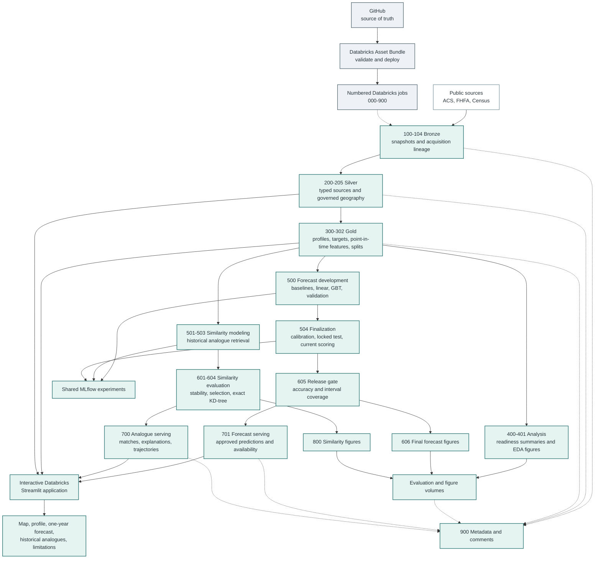

# Neighborhood Housing Intelligence & Digital Twin

An interactive, map-based research platform for exploring how U.S. neighborhoods have changed,
how a public single-family housing indicator may evolve, and which earlier communities looked
similar before their later outcomes were known.

This is a data science capstone, not a neighborhood-ranking or home-investment tool. The main work
is the longitudinal data system and the models behind it: tract-level data integration,
time-aware forecasting, uncertainty estimation, geographic evaluation, and historical analogue
retrieval. The application is where those pieces come together in a form people can explore.

> **Project status:** Shared Databricks pipelines populate separate bronze, silver, gold, model,
> evaluation, serving, and quality schemas. The data covers national FHFA tract HPI through 2025,
> 2010-2024 ACS history for the 50 states and Washington, D.C., governed Census geography, and
> point-in-time model features. The live Databricks app serves current profiles, observed history,
> historical analogues, and 46,719 approved one-year forecasts with calibrated intervals. The
> one-year model passed its locked release gate; the three-year method failed accuracy and interval
> coverage and is explicitly withheld. Similarity uses weighted standardized matching with ten
> distinct historical communities and exact KD-tree batch retrieval. Current work is application
> review, dependent similarity refresh, report integration, and final deployment polish.

## What the implemented product does

A user can select a supported 2020 Census tract and:

- review its current housing mix, affordability, population, tenure, and coverage context;
- inspect observed FHFA single-family HPI history;
- see an approved one-year HPI forecast with a calibrated interval and state-trend baseline;
- see a clear reason when a tract or horizon is unavailable;
- find earlier tract-years that looked similar and see what happened afterward;
- inspect actual tract outlines for the selected neighborhood and matched communities;
- review feature-family similarities and differences for an analogue; and
- separate the primary forecast from descriptive historical-analogue evidence.

The FHFA forecast does not cover multifamily prices or every home in a tract. The application
shows the broader housing-stock composition so that limitation stays visible. The project does not
predict individual home values, label neighborhoods as good or bad, or provide buy/sell
recommendations. Scenario simulation and a natural-language AI layer are possible future work,
not current features.

## Core research question

Can appropriately licensed public data support useful, transferable, interpretable, and
uncertainty-aware models of neighborhood housing trajectories—and can those models power a
credible interactive neighborhood intelligence application?

The project also tests whether tract and regional context improves forecasts, whether historical
analogues add information beyond simple baselines, and whether uncertainty remains calibrated
across locations, time periods, and levels of data coverage.

## Working definition of the Digital Twin

For this project, a Neighborhood Digital Twin is:

> A versioned, time-indexed computational representation of a community that combines observed
> state, historical transitions, geographic context, forecast uncertainty, and comparable
> historical states in an interactive interface.

The name does not imply a perfect replica of a neighborhood, live sensor coverage, or causal simulation. Those limits will remain visible in the application and final report.

## Current system and next delivery stages



The diagram shows implemented paths only. Forecast and similarity work publish to dedicated model,
evaluation, and serving schemas before the application can read them. Jobs 605 and 701 are
important product boundaries: a finalized forecast can remain in evaluation without being
approved for the app. Quality checks run throughout the pipeline, while job 900 reapplies table
and column metadata after schema-overwriting jobs.

Databricks Free Edition is the shared environment for source snapshots, Delta tables,
transformations, MLflow experiments, figures, and the primary private Streamlit application.
GitHub remains the source of truth for code and review. The application reads the approved
analogue and forecast releases plus narrow profile, history, and geometry tables rather than
downloading national data or training models during a session. Because Databricks Apps require authenticated
access, a separate public mirror remains a deployment fallback if the capstone needs an anonymous
portfolio URL.

## Implemented data scope

The implemented sources are:

- Federal Housing Finance Agency annual single-family census-tract House Price Index;
- American Community Survey five-year estimates, margins of error, and housing-stock composition;
- Census tract boundaries and geographic relationship files.

Building permits, employment access, business activity, macroeconomic series, and environmental
risk remain possible extensions. A source is added only when its timing, coverage, geography,
licensing, and out-of-time value can be defended. See [DATA_SOURCES.md](DATA_SOURCES.md) for the
source policy.

## Implemented modeling approach

The model ladder is intentionally conservative:

1. zero-change, historical-average, persistence, and regional baselines;
2. a regularized linear model;
3. one gradient-boosted tree model;
4. training-fold feature-family ablations;
5. split-conformal uncertainty intervals;
6. standardized-feature and PCA representations for historical analogues;
7. exact KD-tree batch retrieval after approximate LSH retrieval failed to reduce work.

Forecast evaluation uses time-based splits and deterministic state holdouts. Errors and coverage
are also reported by housing-stock composition and other important slices. Historical analogues
are tested retrospectively by retrieving matches using only information available at the query
date and then examining known later outcomes. Random row splitting is not appropriate for repeated
tract observations and overlapping ACS releases.

## Repository map

| Path | Purpose |
|---|---|
| [PROJECT_CHARTER.md](PROJECT_CHARTER.md) | Canonical scope, research questions, non-goals, and definition of success |
| [ROADMAP.md](ROADMAP.md) | Twelve-week delivery plan, decision gates, and team ownership options |
| [docs/](docs/) | Architecture, domain-specific EDA and model documentation, run order, implementation plan, and one reference document per data table |
| [data/](data/) | Local-only raw, interim, processed, and demonstration data zones |
| [notebooks/](notebooks/) | Numbered exploration and communication notebooks; reusable logic belongs in `src/` |
| [src/](src/) | Reusable acquisition, validation, geography, feature, modeling, simulation, and export code |
| [tests/](tests/) | Unit, contract, integration, regression, and application smoke tests |
| [app/](app/) | Streamlit entry point, pages, components, and static assets |
| [reports/](reports/) | Written deliverables and code-generated figures and tables |

This layout stays intentionally small. A new folder should appear only when working code or a required deliverable has a clear need for it.

## Documentation path

Start with:

1. [Project charter](PROJECT_CHARTER.md)
2. [Twelve-week roadmap](ROADMAP.md)
3. [Documentation index](docs/README.md)
4. [EDA documentation](docs/eda/README.md)
5. [Forecasting documentation](docs/forecasting/README.md)
6. [Similarity documentation](docs/similarity/README.md)
7. [Model-evaluation documentation](docs/model_evaluation/README.md)
8. [Application documentation](docs/application/README.md)
9. [Databricks pipeline run order](docs/PIPELINE_RUN_ORDER.md)
10. [Data guide and per-table documentation](docs/data/README.md)
11. [Implementation sequence](docs/implementation/README.md)
12. [System architecture](docs/ARCHITECTURE.md)

The implementation guide is numbered in dependency order. It is a living technical plan, not a claim that every optional feature must be built.

## How to run the project

The repository has two execution environments:

- **Local Python** is used for package development, linting, type checking, and tests against small
  fixtures. It does not reproduce the national Spark pipeline.
- **Databricks serverless jobs** run acquisition, ETL, validation, modeling, MLflow tracking, and
  figure generation against the shared Unity Catalog tables.

The Streamlit application is implemented with current neighborhood profiles, observed FHFA
history, the validated historical-analogue release, and a quality-gated one-year forecast release.
The three-year horizon remains explicit but unavailable because it failed its locked test.
Scenario sensitivity is not implemented.

### Prerequisites

- Git and access to this repository;
- Python 3.11, which is the version used by CI (`pyproject.toml` also permits Python 3.12);
- Databricks CLI version `0.218.0` or newer, as enforced by `databricks.yml`;
- membership in the shared Databricks workspace with access to the `workspace` Unity Catalog
  catalog and serverless jobs; and
- a Census API key stored in the Databricks secret scope only when acquiring or refreshing ACS
  source data. Local tests and downstream runs against the existing shared tables do not need the
  key.

Run every command below from the repository root.

### 1. Install and validate the local code

PowerShell:

```powershell
git clone <repository-url>
Set-Location neighborhood-digital-twin
py -3.11 -m venv .venv
.\.venv\Scripts\Activate.ps1
python -m pip install --upgrade pip
python -m pip install -e ".[dev,app]"
python -m ruff check .
python -m mypy src app/neighborhood_app
python -m pytest
```

macOS or Linux:

```bash
git clone <repository-url>
cd neighborhood-digital-twin
python3.11 -m venv .venv
source .venv/bin/activate
python -m pip install --upgrade pip
python -m pip install -e ".[dev,app]"
python -m ruff check .
python -m mypy src app/neighborhood_app
python -m pytest
```

A successful local check requires all three commands—Ruff, mypy, and pytest—to pass. The tests use
small committed fixtures; they do not download or process the national datasets.

### 2. Run the application locally

The default local mode is an explicit reduced sample made from real public project data. It does
not require Databricks credentials:

```powershell
python -m streamlit run app/streamlit_app.py
```

The banner identifies sample mode, which contains one tract and one historical match for interface
testing. It is not the national application release. Run the focused contract and startup tests
with:

```powershell
python -m pytest tests/unit/test_app_data.py tests/unit/test_app_presentation.py
```

### 3. Authenticate and deploy Databricks jobs and the application

The bundle deploys source files and job definitions from the local Git checkout. Do not create a
second repository clone inside the Databricks workspace.

Authenticate once with an OAuth profile named `neighborhood-twin`, then confirm the active user:

```powershell
databricks --version
databricks auth login --host https://<your-workspace-host> --profile neighborhood-twin
databricks current-user me --profile neighborhood-twin
```

Before running project code, validate and deploy the checked-out branch to the shared `team`
target:

```powershell
databricks bundle validate --profile neighborhood-twin -t team
databricks bundle deploy --profile neighborhood-twin -t team
```

Deployment updates code and job definitions; it does not run a job or rebuild a table. Coordinate
the deployment window with the other teammate so two branches do not replace the same shared job
definitions.

To deploy the private SQL-backed Streamlit app after bundle deployment:

```powershell
databricks bundle run neighborhood_housing_intelligence --profile neighborhood-twin -t team
databricks apps get neighborhood-intelligence --profile neighborhood-twin --output json
```

The app uses its own service principal, one `CAN_USE` SQL warehouse resource, and `SELECT` access
only to the twelve declared profile, history, geometry, manifest, analogue, and forecast tables. Sharing app
access is a separate deliberate workspace action; source deployment does not grant the entire
workspace access.

### 4. Reproduce the current EDA, model results, and figures

The following sequence assumes the shared bronze, silver, gold, and model-readiness tables already
exist and have passed their quality checks. It reproduces the implemented report inputs without
rerunning source acquisition:

```powershell
# Rebuild governed readiness summaries and the 12 EDA figures.
databricks bundle run data_readiness_eda --profile neighborhood-twin -t team
databricks bundle run visual_eda --profile neighborhood-twin -t team

# Refit the development baselines and publish validation-only outputs.
databricks bundle run forecast_baselines --profile neighborhood-twin -t team
databricks bundle run similarity_baselines --profile neighborhood-twin -t team
databricks bundle run historical_analogue_baseline --profile neighborhood-twin -t team
databricks bundle run historical_analogue_audit --profile neighborhood-twin -t team
databricks bundle run historical_analogue_selection --profile neighborhood-twin -t team
databricks bundle run current_analogue_retrieval --profile neighborhood-twin -t team
databricks bundle run scalable_analogue_retrieval --profile neighborhood-twin -t team
databricks bundle run analogue_tree_retrieval --profile neighborhood-twin -t team
databricks bundle run analogue_serving_products --profile neighborhood-twin -t team

# Render the 7 model-evaluation figures from the two completed model runs.
databricks bundle run model_evaluation_figures --profile neighborhood-twin -t team

# After the champion contract is frozen, finalize once, gate, visualize, and serve forecasts.
databricks bundle run forecast_finalization --profile neighborhood-twin -t team
databricks bundle run forecast_release_gate --profile neighborhood-twin -t team
databricks bundle run forecast_final_evaluation_figures --profile neighborhood-twin -t team
databricks bundle run forecast_serving_products --profile neighborhood-twin -t team

# Render the reviewed 5-figure similarity package and standup walkthrough inputs.
databricks bundle run similarity_communication_figures --profile neighborhood-twin -t team

# Reapply descriptions and column comments after table-overwriting jobs.
databricks bundle run table_metadata_pipeline --profile neighborhood-twin -t team
```

The forecast and current-state similarity jobs are independent after their upstream tables exist.
The historical analogue job waits for model readiness and the forecast comparators. The evaluation
figure job currently waits for forecast and current-state similarity. Job 800 reads the approved
analogue audit, selection, exact-retrieval, and serving outputs; it does not retrain the method.
Jobs 500-604 are development or similarity-evaluation workflows and do not open the forecast
locked temporal outcomes. Job 504 is the deliberate exception: run it only after model choices
and the interval method are frozen. Jobs 605, 606, and 701 read its unchanged outputs and do not
retune the model.

### 5. Run only the stage affected by a change

Routine development should start at the first changed stage rather than rerunning the national
pipeline:

| Change | Jobs to run after deployment |
|---|---|
| Documentation or local unit-test change | No Databricks job |
| EDA summary or figure code | `data_readiness_eda`, `visual_eda`, then `table_metadata_pipeline` |
| Forecast development code | `forecast_baselines`, `model_evaluation_figures`, then `table_metadata_pipeline` |
| Frozen forecast release packaging or figures | `forecast_release_gate`, `forecast_final_evaluation_figures`, `forecast_serving_products`, then `table_metadata_pipeline` |
| Current-state similarity code | `similarity_baselines`, `model_evaluation_figures`, then `table_metadata_pipeline` |
| Historical analogue code | `historical_analogue_baseline`, then `table_metadata_pipeline` |
| Approved current-analogue serving release | `analogue_serving_products`, then `table_metadata_pipeline` |
| Similarity communication design or approved upstream evidence | `similarity_communication_figures`, then `table_metadata_pipeline` |
| Point-in-time features or split rules | `gold_model_readiness`, affected analysis/modeling jobs, then `table_metadata_pipeline` |
| Historical gold logic | `gold_historical_products`, `gold_model_readiness`, affected downstream jobs, then `table_metadata_pipeline` |
| Source or geography data | Follow the reviewed refresh path in `docs/PIPELINE_RUN_ORDER.md` |

The exact dependency graph, source-refresh sequences, failure recovery, and completion gates are in
the [Databricks pipeline run-order guide](docs/PIPELINE_RUN_ORDER.md). That guide is canonical when
a source, geography, table contract, or job dependency changes.

Do not run `national_historical_acs_backfill` during ordinary development. The national 2010-2024
ACS history is already populated, and that one-time acquisition can run for well over an hour. A
new workspace or genuine source repair also requires the Census secret, reviewed acquisition
scope, and stage-by-stage validation described in [the acquisition guide](docs/implementation/02_data_acquisition_and_pipeline.md).

### Generated results and where to find them

| Result | Generating code | Shared output |
|---|---|---|
| Readiness summaries and 12 EDA figures | `notebooks/04_exploration/01_build_data_readiness.py`, `02_build_visual_eda.py`, and `03_render_eda_figures.py` | `workspace.neighborhood_twin_gold` tables and the `eda_figures` volume |
| Forecast predictions and scorecards | `notebooks/05_modeling/01_run_forecast_baselines.py` | `workspace.neighborhood_twin_model.forecast_baseline_prediction`, `workspace.neighborhood_twin_evaluation.forecast_baseline_scorecard`, and the shared forecast MLflow experiment |
| Final forecast calibration, locked test, and current scoring | `notebooks/05_modeling/10_finalize_forecast.py` | Selection, calibration, locked prediction, locked scorecard, and current prediction tables in the model/evaluation schemas plus the finalization MLflow experiment |
| Forecast release decision | `notebooks/05_modeling/11_evaluate_forecast_release.py` | `workspace.neighborhood_twin_evaluation.forecast_release_gate` |
| Final forecast figures | `notebooks/05_modeling/12_render_forecast_final_evaluation.py` | `forecast_final_evaluation_figure_manifest` and the final-forecast directory in the model-evaluation figure volume |
| Similarity matches and diagnostics | `notebooks/05_modeling/02_run_similarity_baselines.py` | `workspace.neighborhood_twin_model.similarity_baseline_match`, `workspace.neighborhood_twin_evaluation.similarity_baseline_summary`, and the shared similarity MLflow experiment |
| Historical matches, estimates, and evaluation | `notebooks/05_modeling/04_run_historical_analogue_baseline.py` | `historical_analogue_match` and `historical_analogue_prediction` in `workspace.neighborhood_twin_model`; `historical_analogue_summary` and `historical_analogue_scorecard` in `workspace.neighborhood_twin_evaluation`; and the shared historical-analogue MLflow experiment |
| Current analogue application release | `notebooks/06_representations/01_build_analogue_serving_products.py` | Versioned matches, summaries, availability, and activation manifest in `workspace.neighborhood_twin_serving` |
| Current forecast application release | `notebooks/06_representations/02_build_forecast_serving_products.py` | Versioned approved forecasts, complete availability, and activation records in `workspace.neighborhood_twin_serving` |
| Seven model-evaluation figures | `notebooks/05_modeling/03_render_model_evaluation.py` | `workspace.neighborhood_twin_evaluation.model_evaluation_figures` and its manifest table |
| Five similarity communication figures | `notebooks/08_final_analysis/00_render_similarity_communication.py` | `workspace.neighborhood_twin_evaluation.similarity_evaluation_figure_manifest` and the `similarity_evaluation_figures` volume |

The current build IDs, filenames, and export commands are maintained in the
[EDA figure guide](reports/EDA_FIGURES.md) and
[model-evaluation figure guide](reports/MODEL_EVALUATION_FIGURES.md). The five historical-analogue
figures and standup sequence are in the
[similarity figure guide](reports/SIMILARITY_FIGURES.md). Local figure exports belong in the ignored
`reports/generated/` directory.

### Dependencies

The dependency declarations follow the two execution environments:

- [pyproject.toml](pyproject.toml) is authoritative for the local package and development tools.
  `python -m pip install -e ".[dev]"` installs only what the local checks require.
- [databricks.yml](databricks.yml) is authoritative for Databricks serverless job dependencies. It
  pins the job-specific GIS and plotting libraries (`pyshp`, `shapely`, and `matplotlib`), while
  the serverless runtime supplies Spark, Spark ML, MLflow, and its standard data libraries.

Do not add a library simply because it might be useful later. A new local import must be declared
in `pyproject.toml`; a Databricks-only dependency must be added to the relevant bundle environment.

## Data access, credentials, and attribution

The implemented datasets are public U.S. government data from the Census Bureau and FHFA. The
project does not use private partner data, paid data, an NDA, or personally identifiable records.
Raw national files are acquired from the publishers and stored in the shared Databricks bronze
volume; they are not redistributed through Git. Small tracked samples under `data/samples/` are for
inspecting table structure, not reproducing national analyses. Source links, access methods,
limitations, licenses, and redistribution rules are maintained in the
[data access statement](DATA_SOURCES.md).

ACS acquisition requires a Census API key in the Databricks secret scope `neighborhood-twin` under
the key `census-api-key`. Never place the key in source code, a notebook widget value, a local
`.env` file committed to Git, or command output. The acquisition code redacts the key from recorded
source endpoints.

Code copied or adapted from another project must include an inline source link and compatible
license notice next to the relevant code. The complete contribution and attribution rule is in
[CONTRIBUTING.md](CONTRIBUTING.md). Ordinary use of an installed library does not require an inline
source comment, but the dependency must be declared in the correct environment file.

## Development workflow

- `main` is treated as a protected release branch.
- Work happens on descriptive feature branches and is reviewed before merge.
- Notebooks may explore an idea, but reusable transformations and models move into tested modules.
- Large source data, secrets, local MLflow runs, and generated artifacts are not committed.
- Small fixtures, schemas, manifests, configuration, and permitted demonstration outputs are committed when they are needed for reproducibility.
- Model selection stops after a justified champion is chosen; the goal is credible evaluation, not an algorithm contest.

The repository now provides validated bronze, silver, canonical, current gold, historical state,
forecast-target, point-in-time feature, frozen split, and model-panel products. It also provides
time-safe historical analogues, stability and retrieval evaluation, final forecast selection and
uncertainty, explicit forecast release gates, and versioned application-serving contracts. The
interactive Databricks application combines these products now. Remaining work is review and
polish: refresh analogue outputs after upstream model-readiness changes, reconcile any partner
forecast additions, complete report integration, and perform final application testing. Current
figure locations and reproduction steps are documented in the
[EDA figure guide](reports/EDA_FIGURES.md) and
[model evaluation figure guide](reports/MODEL_EVALUATION_FIGURES.md), with the analogue package in
the [similarity figure guide](reports/SIMILARITY_FIGURES.md).

## Planned deployment

- **GitHub:** source of truth, collaboration, code review, CI, releases, and documentation.
- **Databricks Free Edition:** shared raw storage, Delta tables, ETL, Spark work, MLflow experiments, and the primary authenticated Streamlit application.
- **Streamlit Community Cloud:** optional public mirror using a compact serving bundle if anonymous access is required.
- **GitHub Pages:** durable methodology site and static fallback.

If built, the anonymous public mirror will not depend on a live Databricks session. That keeps an open portfolio demonstration usable when free compute is stopped or quota-limited. The deployment design is documented in [docs/implementation/12_deployment_and_operations.md](docs/implementation/12_deployment_and_operations.md).

## Responsible use

Housing appreciation is not a measure of community worth. Historical housing data reflects segregation, unequal access to credit, displacement, and uneven public investment. The project will show affordability pressure and data limitations alongside housing outcomes, avoid moralized neighborhood labels, audit error and coverage across places, and clearly separate prediction from causation.

## AI assistance

AI Assistance:
OpenAI ChatGPT was used for code debugging, code generation, code/repo organization,
and code methodological brainstorming. All final modeling, implementation,
validation, commentary, and interpretation were performed and verified by the authors.

Model used: GPT-5

The required explanation of the AI workflow, model settings, prompt composition, and output evaluation is maintained in the [AI usage appendix](reports/AI_USAGE_APPENDIX.md).

## License

Project code is released under the [MIT License](LICENSE). Source datasets retain their own terms, licenses, and attribution requirements.
