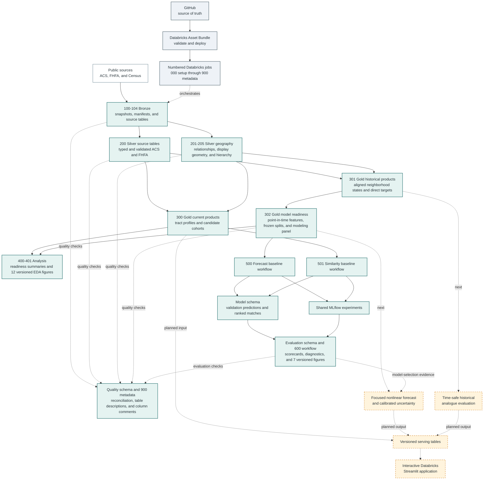

# Neighborhood Housing Intelligence & Digital Twin

An interactive, map-based research platform for exploring how U.S. neighborhoods have changed, how a public single-family housing indicator may evolve, which past communities followed similar paths, and how model results respond to a small set of plausible scenarios.

This is a data science capstone, not a neighborhood-ranking or home-investment tool. The main work is the longitudinal data system and the models behind it: tract-level data integration, time-aware forecasting, uncertainty estimation, spatial analysis, historical analogues, and transparent scenario sensitivity. The application is where those pieces come together in a form people can actually explore.

> **Project status:** Shared Databricks pipelines now populate separate bronze, silver, gold, model, evaluation, and quality schemas. They include complete 2010-2024 ACS history for the 50 states and Washington, D.C., national FHFA history, a valid country-to-tract Census hierarchy, canonical 2020 tract geography, a reviewed Connecticut identity bridge, current and historical analytical products, twelve versioned EDA figures, and seven model-evaluation figures. The national ACS load contains all 765 required state-release pairs and passed bronze, silver, and gold validation. Complete source coverage does not mean identical tract coverage over time: the historical state uses 59,607 stable 2010-to-2020 tracts for each pre-2020 ACS release, while later releases retain roughly 84,400 supported tracts. Leakage-safe model features, frozen temporal and geographic assignments, and a joined modeling panel are live for 63,367 tracts. Forecast and current-state similarity baselines now run as tracked MLflow experiments; the next work is focused nonlinear comparison, uncertainty calibration, time-safe analogue evaluation, and a descriptive application shell. Features described below are planned unless explicitly marked complete.

## What the finished product should do

A user should be able to select a supported census tract and:

- review its housing mix, affordability, demographic, economic, development, and environmental history;
- see a one-year FHFA single-family HPI forecast, with longer horizons only where the data supports them;
- view uncertainty ranges beside every forecast rather than only a point estimate;
- compare the model with persistence and regional baselines;
- find earlier tract-years that looked similar and see what happened afterward;
- compare the tract with its neighbors or another selected area;
- inspect the main factors associated with the model's prediction;
- change a few bounded scenario assumptions and compare the resulting forecast distributions;
- see warnings when a scenario is historically unusual or outside the model's reliable support.

The FHFA forecast does not cover multifamily prices or every home in a tract. The application will show the tract's broader housing-stock composition and make that limitation visible. The scenario laboratory will describe model sensitivity, not causal policy effects. The project will not predict individual home values, label neighborhoods as good or bad, or provide buy/sell recommendations.

## Core research question

Can appropriately licensed public data support useful, transferable, interpretable, and uncertainty-aware models of neighborhood trajectories—and can those models power a credible interactive Neighborhood Digital Twin?

The project will also test whether spatial and metropolitan context improve forecasts, whether historical analogues add information beyond simple baselines, and whether uncertainty remains calibrated across locations, time periods, and levels of data coverage.

## Working definition of the Digital Twin

For this project, a Neighborhood Digital Twin is:

> A versioned, time-indexed computational representation of a community that combines observed state, historical transitions, spatial context, forecast distributions, comparable historical states, and transparent scenario sensitivity in an interactive interface.

The name does not imply a perfect replica of a neighborhood, live sensor coverage, or causal simulation. Those limits will remain visible in the application and final report.

## Current system and next delivery stages



Teal nodes are implemented; gold nodes with dashed borders are the next planned delivery stages.
The diagram reflects the current operational split: current and historical gold products are built
separately, forecast and similarity baselines publish to dedicated model and evaluation schemas,
and EDA and model figures are versioned Databricks outputs. Quality checks run throughout the
pipeline, while job 900 reapplies table and column metadata after schema-overwriting jobs.

Databricks Free Edition is the shared environment for source snapshots, Delta tables,
transformations, MLflow experiments, figures, and the planned primary Streamlit application.
GitHub remains the source of truth for code and review. The application will read compact serving
tables rather than downloading national data or training models during a session. Because
Databricks Apps require authenticated access, a separate public mirror remains a deployment
fallback if the capstone needs an anonymous portfolio URL.

## Initial data scope

The core candidate sources are:

- Federal Housing Finance Agency annual single-family census-tract House Price Index;
- American Community Survey five-year estimates, margins of error, and housing-stock composition;
- Census tract boundaries and geographic relationship files;
- FRED or ALFRED economic series for national and regional context.

Building permits, employment access, business activity, and environmental risk remain possible extensions. A source is added only when its timing, coverage, geography, licensing, and out-of-time value can be defended. See [DATA_SOURCES.md](DATA_SOURCES.md) for the source policy.

## Modeling plan

The initial model ladder is intentionally conservative:

1. zero-change, historical-average, persistence, and regional baselines;
2. a regularized linear model;
3. one gradient-boosted tree model;
4. spatial-context ablations;
5. quantile or conformal uncertainty intervals;
6. standardized-feature and PCA representations for historical analogues;
7. trajectory clustering or learned embeddings only if the simpler approach is complete and a harder method adds measurable value.

Forecast evaluation will use time-based splits and a separate geographic holdout to test transfer to metros the model did not see during training. Errors and coverage will also be reported by housing-stock composition. Historical analogues will be tested retrospectively by retrieving matches using only information available at an earlier date and then comparing their later outcomes with simple geographic and random alternatives. Random row splitting is not appropriate for repeated tract observations and overlapping ACS releases.

## Repository map

| Path | Purpose |
|---|---|
| [PROJECT_CHARTER.md](PROJECT_CHARTER.md) | Canonical scope, research questions, non-goals, and definition of success |
| [ROADMAP.md](ROADMAP.md) | Twelve-week delivery plan, decision gates, and team ownership options |
| [docs/](docs/) | Architecture, implementation guide, and one reference document per data table |
| [data/](data/) | Local-only raw, interim, processed, and demonstration data zones |
| [notebooks/](notebooks/) | Numbered exploration and communication notebooks; reusable logic belongs in `src/` |
| [src/](src/) | Reusable acquisition, validation, geography, feature, modeling, simulation, and export code |
| [tests/](tests/) | Unit, contract, integration, regression, and application smoke tests |
| [app/](app/) | Streamlit entry point, pages, components, and static assets |
| [reports/](reports/) | Written deliverables and code-generated figures and tables |

This layout stays intentionally small. A new folder should appear only when working code or a required deliverable has a clear need for it.

## Documentation path

Start with:

1. [Project charter](PROJECT_CHARTER.md)
2. [Twelve-week roadmap](ROADMAP.md)
3. [Documentation index](docs/README.md)
4. [Databricks pipeline run order](docs/PIPELINE_RUN_ORDER.md)
5. [Data guide and per-table documentation](docs/data/README.md)
6. [Implementation sequence](docs/implementation/README.md)
7. [System architecture](docs/ARCHITECTURE.md)

The implementation guide is numbered in dependency order. It is a living technical plan, not a claim that every optional feature must be built.

## How to run the project

The repository has two execution environments:

- **Local Python** is used for package development, linting, type checking, and tests against small
  fixtures. It does not reproduce the national Spark pipeline.
- **Databricks serverless jobs** run acquisition, ETL, validation, modeling, MLflow tracking, and
  figure generation against the shared Unity Catalog tables.

The interactive application, calibrated uncertainty workflow, final time-safe analogue workflow,
and locked-test release have not been implemented yet. There is currently no application-start
command to run.

### Prerequisites

- Git and access to this repository;
- Python 3.11, which is the version used by CI (`pyproject.toml` also permits Python 3.12);
- Databricks CLI version `0.218.0` or newer, as enforced by `databricks.yml`;
- membership in the shared Databricks workspace with access to the `workspace` Unity Catalog
  catalog and serverless jobs; and
- a Census API key stored in the Databricks secret scope only when acquiring or refreshing ACS
  source data. Local tests and downstream runs against the existing shared tables do not need the
  key.

Run every command below from the repository root.

### 1. Install and validate the local code

PowerShell:

```powershell
git clone <repository-url>
Set-Location neighborhood-digital-twin
py -3.11 -m venv .venv
.\.venv\Scripts\Activate.ps1
python -m pip install --upgrade pip
python -m pip install -e ".[dev]"
python -m ruff check .
python -m mypy src
python -m pytest
```

macOS or Linux:

```bash
git clone <repository-url>
cd neighborhood-digital-twin
python3.11 -m venv .venv
source .venv/bin/activate
python -m pip install --upgrade pip
python -m pip install -e ".[dev]"
python -m ruff check .
python -m mypy src
python -m pytest
```

A successful local check requires all three commands—Ruff, mypy, and pytest—to pass. The tests use
small committed fixtures; they do not download or process the national datasets.

### 2. Authenticate and deploy the Databricks jobs

The bundle deploys source files and job definitions from the local Git checkout. Do not create a
second repository clone inside the Databricks workspace.

Authenticate once with an OAuth profile named `neighborhood-twin`, then confirm the active user:

```powershell
databricks --version
databricks auth login --host https://<your-workspace-host> --profile neighborhood-twin
databricks current-user me --profile neighborhood-twin
```

Before running project code, validate and deploy the checked-out branch to the shared `team`
target:

```powershell
databricks bundle validate --profile neighborhood-twin -t team
databricks bundle deploy --profile neighborhood-twin -t team
```

Deployment updates code and job definitions; it does not run a job or rebuild a table. Coordinate
the deployment window with the other teammate so two branches do not replace the same shared job
definitions.

### 3. Reproduce the current EDA, model results, and figures

The following sequence assumes the shared bronze, silver, gold, and model-readiness tables already
exist and have passed their quality checks. It reproduces the implemented report inputs without
rerunning source acquisition:

```powershell
# Rebuild governed readiness summaries and the 12 EDA figures.
databricks bundle run data_readiness_eda --profile neighborhood-twin -t team
databricks bundle run visual_eda --profile neighborhood-twin -t team

# Refit the development baselines and publish validation-only outputs.
databricks bundle run forecast_baselines --profile neighborhood-twin -t team
databricks bundle run similarity_baselines --profile neighborhood-twin -t team

# Render the 7 model-evaluation figures from the two completed model runs.
databricks bundle run model_evaluation_figures --profile neighborhood-twin -t team

# Reapply descriptions and column comments after table-overwriting jobs.
databricks bundle run table_metadata_pipeline --profile neighborhood-twin -t team
```

The forecast and similarity jobs are independent after their upstream tables exist; the evaluation
job must wait for both. These are development runs. They do not open or score the locked temporal
test outcomes.

### 4. Run only the stage affected by a change

Routine development should start at the first changed stage rather than rerunning the national
pipeline:

| Change | Jobs to run after deployment |
|---|---|
| Documentation or local unit-test change | No Databricks job |
| EDA summary or figure code | `data_readiness_eda`, `visual_eda`, then `table_metadata_pipeline` |
| Forecast code | `forecast_baselines`, `model_evaluation_figures`, then `table_metadata_pipeline` |
| Similarity code | `similarity_baselines`, `model_evaluation_figures`, then `table_metadata_pipeline` |
| Point-in-time features or split rules | `gold_model_readiness`, affected analysis/modeling jobs, then `table_metadata_pipeline` |
| Historical gold logic | `gold_historical_products`, `gold_model_readiness`, affected downstream jobs, then `table_metadata_pipeline` |
| Source or geography data | Follow the reviewed refresh path in `docs/PIPELINE_RUN_ORDER.md` |

The exact dependency graph, source-refresh sequences, failure recovery, and completion gates are in
the [Databricks pipeline run-order guide](docs/PIPELINE_RUN_ORDER.md). That guide is canonical when
a source, geography, table contract, or job dependency changes.

Do not run `national_historical_acs_backfill` during ordinary development. The national 2010-2024
ACS history is already populated, and that one-time acquisition can run for well over an hour. A
new workspace or genuine source repair also requires the Census secret, reviewed acquisition
scope, and stage-by-stage validation described in [the acquisition guide](docs/implementation/02_data_acquisition_and_pipeline.md).

### Generated results and where to find them

| Result | Generating code | Shared output |
|---|---|---|
| Readiness summaries and 12 EDA figures | `notebooks/04_exploration/01_build_data_readiness.py`, `02_build_visual_eda.py`, and `03_render_eda_figures.py` | `workspace.neighborhood_twin_gold` tables and the `eda_figures` volume |
| Forecast predictions and scorecards | `notebooks/05_modeling/01_run_forecast_baselines.py` | `workspace.neighborhood_twin_model.forecast_baseline_prediction`, `workspace.neighborhood_twin_evaluation.forecast_baseline_scorecard`, and the shared forecast MLflow experiment |
| Similarity matches and diagnostics | `notebooks/05_modeling/02_run_similarity_baselines.py` | `workspace.neighborhood_twin_model.similarity_baseline_match`, `workspace.neighborhood_twin_evaluation.similarity_baseline_summary`, and the shared similarity MLflow experiment |
| Seven model-evaluation figures | `notebooks/05_modeling/03_render_model_evaluation.py` | `workspace.neighborhood_twin_evaluation.model_evaluation_figures` and its manifest table |

The current build IDs, filenames, and export commands are maintained in the
[EDA figure guide](reports/EDA_FIGURES.md) and
[model-evaluation figure guide](reports/MODEL_EVALUATION_FIGURES.md). Local figure exports belong in
the ignored `reports/generated/` directory.

### Dependencies

The dependency declarations follow the two execution environments:

- [pyproject.toml](pyproject.toml) is authoritative for the local package and development tools.
  `python -m pip install -e ".[dev]"` installs only what the local checks require.
- [databricks.yml](databricks.yml) is authoritative for Databricks serverless job dependencies. It
  pins the job-specific GIS and plotting libraries (`pyshp`, `shapely`, and `matplotlib`), while
  the serverless runtime supplies Spark, Spark ML, MLflow, and its standard data libraries.

Do not add a library simply because it might be useful later. A new local import must be declared
in `pyproject.toml`; a Databricks-only dependency must be added to the relevant bundle environment.

## Data access, credentials, and attribution

The implemented datasets are public U.S. government data from the Census Bureau and FHFA. The
project does not use private partner data, paid data, an NDA, or personally identifiable records.
Raw national files are acquired from the publishers and stored in the shared Databricks bronze
volume; they are not redistributed through Git. Small tracked samples under `data/samples/` are for
inspecting table structure, not reproducing national analyses. Source links, access methods,
limitations, licenses, and redistribution rules are maintained in the
[data access statement](DATA_SOURCES.md).

ACS acquisition requires a Census API key in the Databricks secret scope `neighborhood-twin` under
the key `census-api-key`. Never place the key in source code, a notebook widget value, a local
`.env` file committed to Git, or command output. The acquisition code redacts the key from recorded
source endpoints.

Code copied or adapted from another project must include an inline source link and compatible
license notice next to the relevant code. The complete contribution and attribution rule is in
[CONTRIBUTING.md](CONTRIBUTING.md). Ordinary use of an installed library does not require an inline
source comment, but the dependency must be declared in the correct environment file.

## Development workflow

- `main` is treated as a protected release branch.
- Work happens on descriptive feature branches and is reviewed before merge.
- Notebooks may explore an idea, but reusable transformations and models move into tested modules.
- Large source data, secrets, local MLflow runs, and generated artifacts are not committed.
- Small fixtures, schemas, manifests, configuration, and permitted demonstration outputs are committed when they are needed for reproducibility.
- Model selection stops after a justified champion is chosen; the goal is credible evaluation, not an algorithm contest.

The repository now provides validated bronze, silver, canonical, current gold, historical state,
forecast-target, point-in-time feature, frozen split, and model-panel products. It also provides
initial forecast and similarity outputs in a dedicated model schema and governed diagnostics in
a separate evaluation schema. These are development baselines, not final models: model selection,
calibrated uncertainty, retrospective analogue evaluation, serving products, and the interactive
application remain. Current figure locations and reproduction steps are documented in the
[EDA figure guide](reports/EDA_FIGURES.md) and
[model evaluation figure guide](reports/MODEL_EVALUATION_FIGURES.md).

## Planned deployment

- **GitHub:** source of truth, collaboration, code review, CI, releases, and documentation.
- **Databricks Free Edition:** shared raw storage, Delta tables, ETL, Spark work, MLflow experiments, and the primary authenticated Streamlit application.
- **Streamlit Community Cloud:** optional public mirror using a compact serving bundle if anonymous access is required.
- **GitHub Pages:** durable methodology site and static fallback.

If built, the anonymous public mirror will not depend on a live Databricks session. That keeps an open portfolio demonstration usable when free compute is stopped or quota-limited. The deployment design is documented in [docs/implementation/12_deployment_and_operations.md](docs/implementation/12_deployment_and_operations.md).

## Responsible use

Housing appreciation is not a measure of community worth. Historical housing data reflects segregation, unequal access to credit, displacement, and uneven public investment. The project will show affordability pressure and data limitations alongside housing outcomes, avoid moralized neighborhood labels, audit error and coverage across places, and clearly separate prediction from causation.

## AI assistance

AI Assistance:
OpenAI ChatGPT was used for code debugging, code generation, code/repo organization,
and code methodological brainstorming. All final modeling, implementation,
validation, commentary, and interpretation were performed and verified by the authors.

Model used: GPT-5

The required explanation of the AI workflow, model settings, prompt composition, and output evaluation is maintained in the [AI usage appendix](reports/AI_USAGE_APPENDIX.md).

## License

Project code is released under the [MIT License](LICENSE). Source datasets retain their own terms, licenses, and attribution requirements.
