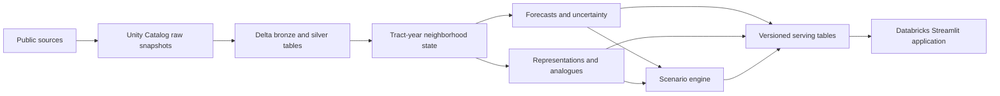

# Neighborhood Housing Intelligence & Digital Twin

An interactive, map-based research platform for exploring how U.S. neighborhoods have changed, how a public single-family housing indicator may evolve, which past communities followed similar paths, and how model results respond to a small set of plausible scenarios.

This is a data science capstone, not a neighborhood-ranking or home-investment tool. The main work is the longitudinal data system and the models behind it: tract-level data integration, time-aware forecasting, uncertainty estimation, spatial analysis, historical analogues, and transparent scenario sensitivity. The application is where those pieces come together in a form people can actually explore.

> **Project status:** The shared Databricks bronze and silver pipelines are implemented and validated for the three-state feasibility pilot, including 2014, 2019, and 2024 ACS releases. The national Census tract relationship and simplified display-geometry products are also live and validated. Usable FHFA coverage remains selective, the relationship file does not provide population or housing weights, and display geometry is not suitable for scientific adjacency. The next milestone is the canonical 2020 tract dimension and a separate analysis-geometry decision before broader historical expansion. Features described below are planned unless explicitly marked complete.

## What the finished product should do

A user should be able to select a supported census tract and:

- review its housing mix, affordability, demographic, economic, development, and environmental history;
- see a one-year FHFA single-family HPI forecast, with longer horizons only where the data supports them;
- view uncertainty ranges beside every forecast rather than only a point estimate;
- compare the model with persistence and regional baselines;
- find earlier tract-years that looked similar and see what happened afterward;
- compare the tract with its neighbors or another selected area;
- inspect the main factors associated with the model's prediction;
- change a few bounded scenario assumptions and compare the resulting forecast distributions;
- see warnings when a scenario is historically unusual or outside the model's reliable support.

The FHFA forecast does not cover multifamily prices or every home in a tract. The application will show the tract's broader housing-stock composition and make that limitation visible. The scenario laboratory will describe model sensitivity, not causal policy effects. The project will not predict individual home values, label neighborhoods as good or bad, or provide buy/sell recommendations.

## Core research question

Can appropriately licensed public data support useful, transferable, interpretable, and uncertainty-aware models of neighborhood trajectories—and can those models power a credible interactive Neighborhood Digital Twin?

The project will also test whether spatial and metropolitan context improve forecasts, whether historical analogues add information beyond simple baselines, and whether uncertainty remains calibrated across locations, time periods, and levels of data coverage.

## Working definition of the Digital Twin

For this project, a Neighborhood Digital Twin is:

> A versioned, time-indexed computational representation of a community that combines observed state, historical transitions, spatial context, forecast distributions, comparable historical states, and transparent scenario sensitivity in an interactive interface.

The name does not imply a perfect replica of a neighborhood, live sensor coverage, or causal simulation. Those limits will remain visible in the application and final report.

## Planned system



Databricks Free Edition is the shared environment for raw snapshots, Delta tables, transformations, experiments, and the primary Streamlit application. GitHub remains the source of truth for code and review. The application will read compact serving tables rather than downloading national data or training models during a user session. Because Databricks Apps require authenticated access, a separate public mirror remains a deployment fallback if the capstone needs an anonymous portfolio URL.

## Initial data scope

The core candidate sources are:

- Federal Housing Finance Agency annual single-family census-tract House Price Index;
- American Community Survey five-year estimates, margins of error, and housing-stock composition;
- Census tract boundaries and geographic relationship files;
- FRED or ALFRED economic series for national and regional context.

Building permits, employment access, business activity, and environmental risk remain possible extensions. A source is added only when its timing, coverage, geography, licensing, and out-of-time value can be defended. See [DATA_SOURCES.md](DATA_SOURCES.md) for the source policy.

## Modeling plan

The initial model ladder is intentionally conservative:

1. zero-change, historical-average, persistence, and regional baselines;
2. a regularized linear model;
3. one gradient-boosted tree model;
4. spatial-context ablations;
5. quantile or conformal uncertainty intervals;
6. standardized-feature and PCA representations for historical analogues;
7. trajectory clustering or learned embeddings only if the simpler approach is complete and a harder method adds measurable value.

Forecast evaluation will use time-based splits and a separate geographic holdout to test transfer to metros the model did not see during training. Errors and coverage will also be reported by housing-stock composition. Historical analogues will be tested retrospectively by retrieving matches using only information available at an earlier date and then comparing their later outcomes with simple geographic and random alternatives. Random row splitting is not appropriate for repeated tract observations and overlapping ACS releases.

## Repository map

| Path | Purpose |
|---|---|
| [PROJECT_CHARTER.md](PROJECT_CHARTER.md) | Canonical scope, research questions, non-goals, and definition of success |
| [ROADMAP.md](ROADMAP.md) | Twelve-week delivery plan, decision gates, and team ownership options |
| [docs/](docs/) | Architecture, implementation guide, and one reference document per data table |
| [data/](data/) | Local-only raw, interim, processed, and demonstration data zones |
| [notebooks/](notebooks/) | Numbered exploration and communication notebooks; reusable logic belongs in `src/` |
| [src/](src/) | Reusable acquisition, validation, geography, feature, modeling, simulation, and export code |
| [tests/](tests/) | Unit, contract, integration, regression, and application smoke tests |
| [app/](app/) | Streamlit entry point, pages, components, and static assets |
| [reports/](reports/) | Written deliverables and code-generated figures and tables |

This layout stays intentionally small. A new folder should appear only when working code or a required deliverable has a clear need for it.

## Documentation path

Start with:

1. [Project charter](PROJECT_CHARTER.md)
2. [Twelve-week roadmap](ROADMAP.md)
3. [Documentation index](docs/README.md)
4. [Data guide and per-table documentation](docs/data/README.md)
5. [Implementation sequence](docs/implementation/README.md)
6. [System architecture](docs/ARCHITECTURE.md)

The implementation guide is numbered in dependency order. It is a living technical plan, not a claim that every optional feature must be built.

## Run the current code

The repository now contains tested source acquisition, bronze and silver validation, national
geography products, a canonical tract dimension, nationwide current ACS coverage, a three-state
annual ACS panel, and current gold profiles for modeling and application prototypes. The primary
ACS silver product uses one tract-release-measure row with a companion data dictionary, while a
generated wide table supports compact feature construction. The gold layer keeps all canonical
tracts and exposes transparent similarity, forecasting, and application-development cohorts.
Models and the interactive application have not been implemented yet.

PowerShell:

```powershell
py -3.11 -m venv .venv
.\.venv\Scripts\Activate.ps1
python -m pip install --upgrade pip
python -m pip install -e ".[dev]"
python -m ruff check .
python -m mypy src
python -m pytest
```

macOS or Linux:

```bash
python3.11 -m venv .venv
source .venv/bin/activate
python -m pip install --upgrade pip
python -m pip install -e ".[dev]"
python -m ruff check .
python -m mypy src
python -m pytest
```

As executable pipeline stages are added, this section will list the exact commands needed to acquire permitted data, reproduce analysis, generate every reported figure and table, and launch the application. A required command is not considered complete until it works from a clean checkout using relative paths.

The first cloud entry point is [01_ingest_core_sources.py](notebooks/01_feasibility/01_ingest_core_sources.py). It is deployed as a serverless Databricks job through the root [databricks.yml](databricks.yml), so a second Git clone inside the Databricks workspace is not required. After authenticating the Databricks CLI with a local profile named `neighborhood-twin`, run:

```powershell
databricks bundle validate --profile neighborhood-twin
databricks bundle deploy --profile neighborhood-twin
databricks bundle run core_source_ingestion --profile neighborhood-twin
databricks bundle run historical_acs_ingestion --profile neighborhood-twin
databricks bundle run pilot_annual_acs_ingestion --profile neighborhood-twin
databricks bundle run national_current_acs_ingestion --profile neighborhood-twin
databricks bundle run silver_source_transforms --profile neighborhood-twin
databricks bundle run geography_relationship_pipeline --profile neighborhood-twin
databricks bundle run display_geometry_pipeline --profile neighborhood-twin
databricks bundle run canonical_geography_pipeline --profile neighborhood-twin
databricks bundle run gold_current_products --profile neighborhood-twin
databricks bundle run table_metadata_pipeline --profile neighborhood-twin
```

The jobs remain separate so acquisition, transformation, geography, current products, and metadata
can be rerun and reviewed independently. Run expansion jobs only after checking their configured
scope, rebuild silver after new ACS snapshots arrive, and apply table metadata after any job that
overwrites a schema. Raw source files and secrets remain outside Git. Complete table grains and
limitations are in the [data guide](docs/data/README.md); setup and pipeline details are in
[Stage 02](docs/implementation/02_data_acquisition_and_pipeline.md), and geography decisions are in
[Stage 03](docs/implementation/03_geography_and_time_alignment.md).

## Development workflow

- `main` is treated as a protected release branch.
- Work happens on descriptive feature branches and is reviewed before merge.
- Notebooks may explore an idea, but reusable transformations and models move into tested modules.
- Large source data, secrets, local MLflow runs, and generated artifacts are not committed.
- Small fixtures, schemas, manifests, configuration, and permitted demonstration outputs are committed when they are needed for reproducibility.
- Model selection stops after a justified champion is chosen; the goal is credible evaluation, not an algorithm contest.

The repository now provides validated bronze, silver, canonical, and current gold products, but it
is not yet a functioning model or application. The Connecticut current-geography bridge,
point-in-time historical feature/target tables, exploratory analysis, modeling, evaluation, and
interactive application still remain.

## Planned deployment

- **GitHub:** source of truth, collaboration, code review, CI, releases, and documentation.
- **Databricks Free Edition:** shared raw storage, Delta tables, ETL, Spark work, MLflow experiments, and the primary authenticated Streamlit application.
- **Streamlit Community Cloud:** optional public mirror using a compact serving bundle if anonymous access is required.
- **GitHub Pages:** durable methodology site and static fallback.

If built, the anonymous public mirror will not depend on a live Databricks session. That keeps an open portfolio demonstration usable when free compute is stopped or quota-limited. The deployment design is documented in [docs/implementation/12_deployment_and_operations.md](docs/implementation/12_deployment_and_operations.md).

## Responsible use

Housing appreciation is not a measure of community worth. Historical housing data reflects segregation, unequal access to credit, displacement, and uneven public investment. The project will show affordability pressure and data limitations alongside housing outcomes, avoid moralized neighborhood labels, audit error and coverage across places, and clearly separate prediction from causation.

## AI assistance

AI Assistance:
OpenAI ChatGPT was used for code debugging, code generation, code/repo organization,
and code methodological brainstorming. All final modeling, implementation,
validation, commentary, and interpretation were performed and verified by the authors.

Model used: GPT-5

The required explanation of the AI workflow, model settings, prompt composition, and output evaluation is maintained in the [AI usage appendix](reports/AI_USAGE_APPENDIX.md).

## License

Project code is released under the [MIT License](LICENSE). Source datasets retain their own terms, licenses, and attribution requirements.
