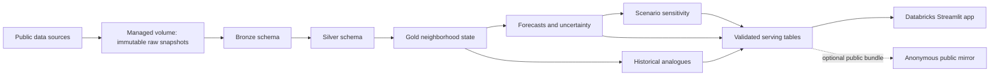

# System Architecture

GitHub is the source of truth for code while Databricks is the shared data and execution environment. Data acquisition, validation, feature construction, model training, and evaluation run as batch work against Unity Catalog. The Streamlit application reads compact, validated serving tables and does not train models or download national datasets during a user session.



## Current repository boundaries

- `src/neighborhood_twin/` contains reusable pipeline, modeling, evaluation, and application-data logic.
- `tests/` verifies that logic with small, redistributable fixtures.
- `notebooks/` is for exploration, communication, and thin Databricks orchestration; reusable logic remains in `src/`.
- `data/` holds local source and processed data that should not normally be committed.
- `app/` contains the Streamlit interface once implementation begins.
- `reports/` contains the report, AI appendix, and code-generated figures and tables.
- `docs/implementation/` contains the detailed build sequence.

New folders should be added only when a working implementation creates a distinct kind of file that does not fit these locations.

## Databricks data boundary

The shared workspace uses an existing Unity Catalog catalog. Pipeline responsibility is separated
at the schema level so raw data, conformed data, analytical products, and operational evidence do
not compete in one long table list:

```text
<catalog>
├── neighborhood_twin_bronze
│   ├── volume: source_snapshots
│   ├── table: source_snapshot_manifest
│   └── tables: bronze_*
├── neighborhood_twin_silver
│   └── tables: silver_*
├── neighborhood_twin_gold
│   └── tables: gold_* and future model/application products
└── neighborhood_twin_quality
    └── tables: *_quality_metrics
```

`neighborhood_twin_test` is reserved for future integration-test fixtures or results, but is not
created until those tests exist. The original `neighborhood_twin_dev` schema is retained unchanged
as a migration source and rollback reference; active jobs no longer write to it. Historical source
paths recorded there remain valid lineage. New snapshots are written to the bronze volume.

Unity Catalog volumes hold files; Unity Catalog managed Delta tables hold tabular data. No workflow uses legacy DBFS mounts. Snapshot hashes and manifests make a source version traceable even when a publisher replaces a file at the same URL. One team member should own a canonical refresh run so two simultaneous notebook runs do not compete to publish the same snapshot.

## Data and modeling boundary

The core analytical table has one row per tract and forecast origin. Every feature must retain its reference period and the date it became available so historical backtests cannot use future information. Geography conversions, missingness, and source coverage must remain visible rather than being hidden by the model.

Training consumes versioned, validated tables. Each experiment records its features, target, time split, geographic holdout, parameters, seed, metrics, and output version. Simple persistence, regional, and linear baselines remain part of the evaluation.

## Application boundary

The Databricks application receives only the data needed for supported views: tract profiles, history, forecasts and intervals, analogues, explanations, scenario definitions, geometry, and version metadata. It must reject incompatible or incomplete inputs and clearly label unavailable results. It should query dedicated serving tables through a SQL warehouse rather than reading raw or training tables.

Databricks Apps cannot be made anonymously public. The primary Databricks application is therefore appropriate for team development, mentor review, and an authenticated demonstration. If the course or portfolio needs an anonymous URL, the same serving contract will be exported as a compact bundle for a public Streamlit mirror; raw tables and Databricks credentials will not be exposed.

## Failure boundaries

The system should fail clearly when:

- a source download is incomplete or changes schema;
- a table has duplicate keys, invalid GEOIDs, or unexpected row loss;
- a feature is unavailable at the stated forecast origin;
- geography matching falls below the accepted threshold;
- model inputs do not match the trained feature definition;
- a scenario is unsupported or outside its permitted range;
- application data is missing, incompatible, or fails validation.

Detailed schemas, configuration files, deployment definitions, and operational instructions should be created alongside the code that uses them, not in advance.
