# 12. Deployment and Operations

Deployment should make the work easy to inspect while keeping the analytical pipeline reproducible. Databricks is the planned shared home for ETL, Delta storage, modeling, and the primary application. The application data contract still remains separate from raw and training data so a public mirror can be added without redesigning the project.

## Recommended deployment shape

Use three connected environments:

1. **GitHub** is the source of truth for code, documentation, reviews, releases, and automated checks.
2. **Databricks Free Edition** is the shared environment for raw snapshots, Delta tables, transformations, model experiments, serving tables, and the primary Streamlit application.
3. **Streamlit Community Cloud**, if needed, is an anonymous public mirror backed by a compact export of the same serving contract. GitHub Pages can provide static documentation and a durable landing page.

Databricks Free Edition currently has quotas, restricted outbound access, serverless-only compute, and no service-level agreement. Free Edition allows up to three apps, and an app stops after 24 hours unless restarted. Databricks Apps cannot be anonymously public. The Databricks app is therefore the primary build and authenticated demonstration target, while the compact public mirror remains necessary if the course or portfolio requires an open URL. Verify these conditions again before the final deployment because free offerings change.

## Environment strategy

| Environment | Purpose | Data | Deployment expectation |
|---|---|---|---|
| Local development | Fast iteration and tests | Small samples or cached public data | Reproducible from documented setup |
| Databricks | Shared pipeline, models, and primary app | Versioned raw files, Delta tables, artifacts, and serving tables | Manual or scheduled runs plus authenticated app within free limits |
| CI | Linting, unit tests, contract tests | Tiny committed fixtures only | Runs on pull requests and protected branches |
| Preview app | Team review of release candidates | Candidate serving bundle | May be private or temporary |
| Public app | Optional anonymous capstone demonstration | Approved, compact serving bundle | Stable URL with no secrets in the client |

Development and production should use the same package functions and contracts. Notebook-only logic should not be required to reproduce a released bundle.

## Build and release flow

```mermaid
flowchart LR
    A[Feature branch] --> B[Automated checks]
    B --> C[Reviewed merge]
    C --> D[Versioned pipeline run]
    D --> E[Evaluation gate]
    E --> F[Serving bundle]
    F --> G[Bundle validation]
    G --> H[Preview deployment]
    H --> I[Release tag]
    I --> J[Public application]
```

The serving bundle should be immutable and identified by a release ID. Code, configuration, raw-source versions, feature schema, model version, and evaluation summary should all be traceable from its manifest.

## Continuous integration

Initial checks should include:

- package installation on the supported Python version;
- linting and formatting validation;
- unit and contract tests;
- import and configuration smoke tests;
- Markdown-link checks when practical;
- detection of accidentally committed secrets or large data files.

Later, add a small application smoke test and, if a public mirror is used, a build check for that host. Heavy training and full data refreshes should not run on every pull request.

## Continuous delivery

Deploy the primary Streamlit interface as a Databricks App connected only to approved serving tables and the smallest practical SQL warehouse. Assign the app's service principal read access to those tables, not to raw or training schemas. Free Edition apps need to be restarted after their run window, so record that step in the demonstration checklist.

If anonymous access is required, Streamlit Community Cloud can deploy the same interface from GitHub against a compact serving bundle. Point that deployment at a stable release branch or tag-derived branch rather than an individual feature branch. The public mirror must not require a Databricks token.

GitHub Pages is appropriate for static documentation, project findings, and a fallback landing page; it cannot run the Python application. Keep a clear link between the landing page, live app, repository, data sources, and model card.

## Secrets and configuration

- Document required setting names only after code reads them; never commit `.env` or credentials.
- Store host secrets in the deployment platform's secret manager.
- Give credentials the narrowest practical permissions.
- Prefer public download URLs and cached snapshots over long-lived personal tokens.
- Do not print secrets in notebook output or CI logs.
- Validate required settings at startup and fail with a useful message.

## Data and artifact publishing

Do not place unrestricted raw extracts or large model artifacts in ordinary Git history. Publish only data that its license permits, and record checksums and source metadata. Small fixtures, aggregated application tables, or release artifacts can use GitHub Releases, object storage, or another documented public location depending on size and terms.

Every bundle release should contain or reference:

- release and schema versions;
- creation timestamp and pipeline commit;
- geography vintage and observation cutoff;
- source snapshot identifiers;
- model and feature versions;
- validation results and known exclusions;
- checksums for included files.

## Reliability and observability

For a capstone, observability can remain lightweight but should still answer whether the application starts, which bundle it serves, and where it fails. Log startup, bundle validation, page-level exceptions, and coarse performance timing without recording user-entered locations or other unnecessary interaction detail.

Add a visible status block containing the model version, data-through date, and last successful release. A simple scheduled health check is optional; the project should not promise high availability on a free service.

## Rollback and recovery

Keep at least one previously validated serving bundle and deployment revision. Rollback should mean selecting the prior known-good bundle and application release, not rerunning the entire pipeline under pressure. Add operational instructions beside the deployment configuration when that configuration exists.

## Current platform references

- [Databricks Free Edition limitations](https://docs.databricks.com/aws/en/getting-started/free-edition-limitations)
- [Databricks Apps overview](https://docs.databricks.com/aws/en/dev-tools/databricks-apps/)
- [Databricks Apps authorization](https://docs.databricks.com/aws/en/dev-tools/databricks-apps/permissions)
- [Streamlit Community Cloud deployment guide](https://docs.streamlit.io/deploy/streamlit-community-cloud/deploy-your-app/deploy)
- [GitHub Pages overview](https://docs.github.com/en/pages/getting-started-with-github-pages/what-is-github-pages)
- [GitHub Actions guide for Python](https://docs.github.com/en/actions/tutorials/build-and-test-code/python)

## Required outputs

- tested environment setup and dependency lock strategy;
- CI checks for the current codebase;
- validated serving-bundle release process;
- working Databricks application with source and methodology links;
- anonymous public mirror only if open access is required;
- deployment and rollback runbooks;
- documented free-tier constraints and fallback demo plan.

## Exit criteria

This stage is complete when a clean environment can test the repository, validated serving data can be promoted without manual file editing, the application identifies exactly what it serves, and the team can restore the prior release if a deployment fails. If anonymous access is required, the public mirror must pass the same checks.
