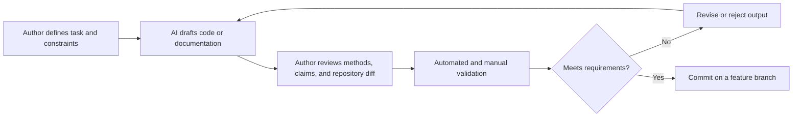

# AI Usage Appendix

This appendix documents how AI assistance was used in the project. It is maintained because AI contributed to repository design, documentation, and code scaffolding. It is not a complete prompt transcript; the capstone checklist identifies a full prompt log as optional.

## How AI fits into the workflow

AI is used as a drafting and development aid. The author defines the task and constraints, reviews the resulting changes, checks them against project and course requirements, runs appropriate validation, and decides whether to revise, retain, or reject the output. AI output is not treated as evidence that code is correct or that an analytical method is valid.

For code, validation may include syntax checks, unit tests, linting, type checks, small known-answer tests, data-contract checks, leakage review, and comparison with a baseline. For documentation, validation includes checking the original source, verifying links and commands, and confirming that planned work is not presented as completed work. Final modeling choices, interpretations, and claims remain the authors' responsibility.

## Models and parameters

| Period or work | Provider and interface | Model | Reasoning effort | Temperature | Other author-selected parameters |
|---|---|---|---|---|---|
| Initial repository and technical design, October 6–7, 2026 | OpenAI ChatGPT/Codex workspace assistant | GPT-5 | Not exposed in the available session metadata | Not exposed or set by the author | None |
| Initial Databricks acquisition and bronze pipeline, October 22, 2026 | OpenAI ChatGPT/Codex workspace assistant | GPT-5 | Not exposed in the available session metadata | Not exposed or set by the author | None |
| Initial Databricks bundle and shared ETL configuration, October 23, 2026 | OpenAI ChatGPT/Codex workspace assistant | GPT-5 | Not exposed in the available session metadata | Not exposed or set by the author | None |
| Bronze quality profiling and feasibility review, October 23, 2026 | OpenAI ChatGPT/Codex workspace assistant | GPT-5 | Not exposed in the available session metadata | Not exposed or set by the author | None |
| FHFA and ACS silver source pipeline, October 23, 2026 | OpenAI ChatGPT/Codex workspace assistant | GPT-5 | Not exposed in the available session metadata | Not exposed or set by the author | None |
| Historical ACS pilot, October 23–24, 2026 | OpenAI ChatGPT/Codex workspace assistant | GPT-5 | Not exposed in the available session metadata | Not exposed or set by the author | None |
| Census tract relationship and display-geometry pipelines, October 24, 2026 | OpenAI ChatGPT/Codex workspace assistant | GPT-5 | Not exposed in the available session metadata | Not exposed or set by the author | None |
| ACS expansion, current analytical products, and data catalog, October 24, 2026 | OpenAI ChatGPT/Codex workspace assistant | GPT-5 | Not exposed in the available session metadata | Not exposed or set by the author | None |

The table records only settings that can be verified. A parameter is marked as not exposed when the interface did not provide its value; no value is inferred. Add a new row whenever a different model, interface, or parameter configuration materially contributes to the project.

## How prompts are composed

Prompts are written around a concrete artifact or outcome and normally include:

1. the task to perform;
2. relevant project context;
3. constraints or requirements that must be preserved;
4. the expected form of the output;
5. a quality or verification standard when the task carries meaningful risk.

Routine exchanges are not preserved as a full log. The example below is included because it initiated the repository's structure and affected how later documentation, code, tests, and deliverables were organized. It records a consequential design request rather than ordinary conversational context.

### Actual prompt example

> Design an initial scaffold for the proposed project repo structure. Include readme files to add context and make suggestions on where organization can improve the project's design.

This prompt identifies a concrete artifact—the initial repository scaffold—while asking for enough README context that another contributor could understand the design. It also leaves room to evaluate the organization rather than assuming the first folder structure is final. That mattered because the repository was developed through several rounds of review and simplification rather than accepted as a one-time generated template.

### Data documentation and metadata prompt

> Add a data folder in docs that provides an outline/summary of each table along the pipeline so it's clear what it is for (granularity, structure, etc.). Put sample data for each table into the data folder (1,000 rows or less depending on the source should do). Finally, it would be good to have solid metadata on the Databricks tables. So a table description and column comments should be added to each source to improve metadata quality.

This request materially changed both the repository documentation and the governed Databricks
objects. It produced one reference document per table, small real samples for every implemented
table, and source-controlled table and column comments rather than leaving data knowledge inside
notebooks.

## How AI output is evaluated

AI output is evaluated against the source requirement and the actual repository state, not only for plausibility or writing quality. A change is reviewed through the Git diff, checked for unsupported claims and scope drift, and tested in proportion to its risk. Analytical code will also be evaluated using held-out data, simple baselines, leakage checks, uncertainty calibration, and error analysis as described in the technical implementation guide.

### Actual evaluation example

The repository scaffold was evaluated iteratively rather than treated as correct because the requested folders and README files had been created. After the initial version, the author reviewed the repository tree and found that it included too many speculative folders and documents for a project that had not begun implementation. Follow-up revisions simplified the structure, clarified which documents were authoritative, kept personal planning material outside version control, and retained folders only when they had an obvious current purpose such as data, source code, tests, notebooks, the application, reports, or active documentation.

Each revision was checked against practical questions:

- Can a new contributor understand the project and find the next implementation step from the root README?
- Does each folder have a distinct responsibility that is likely to remain stable?
- Are optional future capabilities described in planning documents instead of represented by empty infrastructure?
- Are code, tests, data organization, application work, reports, and required deliverables separated without creating unnecessary layers?
- Do Git status and ignore rules keep local notes, credentials, source data, generated artifacts, and licensed reading copies out of the public repository?

The structure was accepted only after those reviews led to concrete changes. This is the intended pattern for AI-assisted repository design: generate an initial proposal, inspect it in the context of the real project, remove or reorganize what does not help, and repeat until the organization supports the work that is actually planned.

The initial Databricks bundle configuration was evaluated against the live workspace rather than accepted because the YAML looked plausible. The configuration passed `databricks bundle validate`, deployed one serverless ingestion job, and completed its first run successfully. A separate Unity Catalog check then confirmed the expected ACS and FHFA bronze tables, source-manifest table, and managed source volume. This sequence checked configuration syntax, workspace authentication, secret access, source connectivity, job execution, and persisted outputs. The deployment would not have been considered successful based only on the job appearing in the interface.

The bronze quality profiler was reviewed through the repository diff, 14 local unit tests, Ruff, mypy, bundle validation, and a full live Databricks run. The live review queried the persisted metrics rather than relying only on the successful job status. That check confirmed zero hard failures and zero warnings, but also exposed the more important feasibility result that only 63.2% of pilot ACS tracts had a non-null same-year FHFA HPI. The profiler was then revised to preserve both row-match coverage and usable-target coverage as separate metrics. This is an example of AI-assisted code being changed after contact with the real data rather than accepted because its initial checks passed.

The silver transformation code was first checked with 18 local unit tests, Ruff, mypy, bundle
validation, and two live runs of the isolated Databricks silver job. The persisted quality table
confirmed that source row counts were preserved and that keys, GEOIDs, ACS parsing, snapshot
selection, and derived-ratio ranges passed. Follow-up SQL checks then examined relative margins
of error and compared ACS tract characteristics by usable FHFA coverage. That review found
material differences between covered and uncovered tracts, so the implementation notes now
require coverage-sliced evaluation and prevent forecasts from being generalized to the full
ACS tract universe.

The ACS silver design was then revised because the original 130-column table was readable but
too wide to be the main interface for repeated exploration and historical expansion. The
revision added a 29-column normalized measure table and a 21-row governed dictionary while
keeping the wide table as a generated convenience product. It passed Ruff, mypy, all 20 local
tests, bundle validation, and two further live Databricks runs. Each live run recorded 34
passing checks, 11 informational measures, and no warnings or failures. Read-only SQL checks
confirmed stable output counts after the rerun and verified per-measure missingness. This
evaluation directly changed the data contract rather than treating a successful first version
as final.

The historical ACS job was evaluated with a deliberately small six-request batch before any
national expansion. All six source responses were acquired, parsed, and written correctly, but
the first job attempt still ended as failed because its final diagnostic display passed a tuple
to Spark Connect as one `isin` value. The persisted bronze partitions were inspected directly
to separate that display problem from acquisition or data loss. The call was corrected to
expand the values, and the rerun completed without duplicating rows. Silver was then rebuilt
twice over 2014, 2019, and 2024. Both runs preserved 23,342 tract-release rows, generated exactly
490,182 tract-release-measure rows, retained one current build per output, and passed all 34
hard checks. The review also confirmed that 15,114 older-vintage rows were labeled and excluded
from direct 2020-vintage FHFA coverage joins until geography harmonization is implemented.

The Census tract relationship pipeline was reviewed with Ruff, mypy, all 31 local tests,
Databricks bundle validation, and live workspace runs. The first live run was correctly blocked
because 597 rows produced null land shares. Rather than weakening the rule immediately, the
source rows were queried and shown to involve valid zero-land-area, water-only tracts: 352 source
tracts and 368 target tracts, with no tract having both zero land and zero water area. The quality
contract was revised to report those cases explicitly while continuing to fail on unexpected
nulls, negative shares, or shares above tolerance. Two subsequent runs succeeded, and a direct
table check confirmed one bronze snapshot, one manifest row, 126,450 silver rows, one current
silver build, eight passing checks, and no warnings or failures. Review of the official record
layout also changed the analytical plan: because the source supplies area overlap rather than
population or housing weights, the project will not use it to redistribute medians, rates, or
indexes.

The display-geometry stage was preceded by a temporary live compatibility probe because no GIS
reader was present in the default Databricks serverless image. A pinned environment with pyshp
2.3.1 and Shapely 2.0.6 successfully opened the registered archive before those dependencies were
added to the production job. The implementation then passed Ruff, mypy, all 33 local tests,
bundle validation, and two live runs. The published table contains 85,187 unique, valid
geometries and one current build. A coverage comparison found 341 relationship tracts without a
display feature: 340 are water-only and the remaining tract is a mostly-water Florida special-use
tract. This review led to a firm scope boundary: simplified cartographic geometry can serve the
application map, but it cannot be used for adjacency or precise spatial model features.

The ACS expansion and current-product work was checked with Ruff, mypy, all 42 local unit tests,
Databricks bundle validation, and live runs of the acquisition, silver, gold, and metadata jobs.
The completed silver build contains 192,883 tract-release rows and 4,050,543 normalized measure
rows. Gold reconciliation retained all 85,528 canonical tracts and reported zero hard failures.
The live join review also found 884 current Connecticut ACS identifiers that did not match the
2020 canonical keys. The discrepancy was traced to Connecticut's adoption of planning regions,
not treated as random missingness. The resulting implementation was checked against official 2020
and 2024 TIGER/Line files: 879 land tracts were unique in both vintages, while the water-only
universe changed from four records to five. The pipeline therefore maps only the 879 one-to-one
land tracts. Local linting, type checks, all 45 unit tests, bundle validation, and three live
Databricks jobs passed. The refreshed gold metrics report 879 bridge matches, five documented
water-only exceptions, and zero unexpected current ACS mismatches. Finally, real samples and
individual table documents were checked for all 23 implemented tables.

The schema reorganization and first EDA-readiness implementation were evaluated with Ruff, Python
compilation, 52 local unit tests, Databricks bundle validation, and live serverless jobs. The
organizer's first run exposed that Spark Connect did not support the proposed `errorifexists`
write mode; it stopped before copying a table, and the implementation was changed to an explicit
create-table-as-select operation that preserves the same create-only behavior. The completed run
copied and reconciled the existing tables into separate bronze, silver, gold, and quality schemas
without changing or deleting the legacy schema.

The EDA job was also revised in response to two live-data failures rather than accepted after its
first successful-looking output. A uniqueness check caught state rows split by null display labels,
so state FIPS became the key and readable labels became nullable attributes. Review of the
published FHFA summary then found that two year fields contained the literal column name; the code
was corrected and hard checks for numeric year types and valid chronological ranges were added.
The final run passed all publication checks. Separate SQL review confirmed 51,263 forecast
candidates after correctly bridging 728 Connecticut FHFA identifiers, viable one-, three-, and
five-year target pairs, and substantial ACS uncertainty in several small housing categories.

## Maintenance requirements

- Update the model table when a materially contributing model or configuration changes.
- Keep only prompt examples that materially shaped the project, resolved a significant problem, or recorded an important design decision.
- Add evaluation evidence for major AI-generated analytical code, not every small edit.
- Never include credentials, private data, proprietary source content, or unnecessary personal information.
- Reconcile this appendix with the final code, report, and contribution statement before submission.
