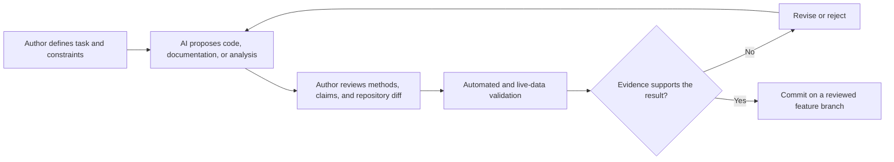

# AI Usage Appendix

AI assistance was used during repository design, code development and debugging, documentation,
and methodological brainstorming. It was not treated as evidence that an implementation was
correct or that a model result was valid. The authors remained responsible for the final methods,
code, validation, interpretation, and written claims.

This appendix addresses the four AI-reporting items in the Capstone Project Specifications. It is
not a complete prompt log; the specification identifies that log as optional.

## How AI fit into the workflow

The authors defined the problem, supplied project context and constraints, and asked for a
specific artifact or investigation. AI produced a draft, diagnostic suggestion, or proposed
change. The authors then reviewed the repository diff and analytical reasoning, ran appropriate
checks, inspected live outputs, and either accepted, revised, or rejected the result.

Validation depended on the artifact. Code changes were checked with unit and contract tests,
Ruff, mypy, Databricks bundle validation, table reconciliations, and live job runs when needed.
Modeling work also used time-aware splits, simple baselines, leakage checks, reserved calibration
periods, and locked temporal tests. Documentation was checked against the implemented repository,
source materials, and generated results so planned work was not described as complete.

## Models and parameter settings

| Provider and interface | Model | Reasoning or effort | Temperature | Other selected settings |
|---|---|---|---|---|
| OpenAI ChatGPT/Codex workspace assistant | GPT-5 | Not exposed in the available session metadata | Not exposed or author-selected | No model parameters were exposed or selected by the authors |
| OpenAI Copilot in VS Code, used on the forecast feature-ablation notebook | Exact underlying model requires contributor confirmation | Not recorded | Not recorded | Not recorded |

The table reports only information that can be verified. Unknown settings are not inferred. The
Copilot row must be completed by the contributing author before final submission if that notebook
remains part of the submitted codebase.

## How prompts were composed

Prompts normally identified the artifact or outcome, supplied the relevant project state, stated
constraints that had to be preserved, and described how the result should be checked. Follow-up
prompts corrected scope, organization, or technical errors discovered during review. Routine
conversation is not reproduced here.

### Actual prompt example

> Design an initial scaffold for the proposed project repo structure. Include readme files to add
> context and make suggestions on where organization can improve the project's design.

This prompt requested a concrete artifact while leaving room to critique the first design. The
result was not accepted as a permanent template. The repository was simplified over several
iterations as implementation clarified which folders, documents, and workflows had stable roles.

## How AI outputs were evaluated

AI-generated or AI-revised work was evaluated against the original request and observable project
evidence. A plausible explanation or successful-looking script was not enough. Review included
the code diff, tests, data contracts, run lineage, model comparisons, and inspection of persisted
tables and figures. Unsupported claims and unnecessary complexity were removed.

### Actual evaluation example

An early forecast-data contract removed every target whose start and end years crossed a calendar
decade. Review showed that this rule mixed two different issues: FHFA already publishes its tract
HPI history on 2020 geography, while the real cross-vintage concern came from pre-2020 ACS
features. The initial rule therefore discarded valid outcomes solely because they crossed
2019–2020.

The team revised the contract so cross-2020 feature histories require the reviewed stable-tract
cohort, while fully observed FHFA outcomes remain eligible. The correction was evaluated through
unit tests, leakage and cohort checks, Ruff, mypy, bundle validation, rebuilt gold/model tables,
and live Databricks runs.

A second review found a separate AI-assisted design error: finalization had promoted the strongest
three-year validation baseline, state trend, into the model slot and withheld the project's actual
linear and nonlinear three-year forecasts. That contradicted the stated goal of comparing
regularized linear regression with gradient-boosted trees. The correction retained both
supervised models at both horizons, moved state and county trends back to baseline-only roles,
calibrated and evaluated each model separately, and changed the application to show weak results
with warnings rather than suppressing them. Tests, table grains, serving reconciliation, figures,
and written interpretations were revised together. This failure is recorded because a technically
consistent pipeline can still implement the wrong research question when model roles are not
checked against the project goal.

## Final responsibility

AI assistance does not change authorship or accountability. The authors are responsible for the
accuracy of the code, the appropriateness of the methods, compliance with source terms, and every
claim in the report and application. Any AI model or parameter information that cannot be
verified will be resolved or clearly disclosed before submission rather than guessed.
