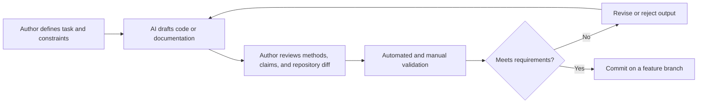

# AI Usage Appendix

This appendix documents how AI assistance was used in the project. It is maintained because AI contributed to repository design, documentation, and code scaffolding. It is not a complete prompt transcript; the capstone checklist identifies a full prompt log as optional.

## How AI fits into the workflow

AI is used as a drafting and development aid. The author defines the task and constraints, reviews the resulting changes, checks them against project and course requirements, runs appropriate validation, and decides whether to revise, retain, or reject the output. AI output is not treated as evidence that code is correct or that an analytical method is valid.

For code, validation may include syntax checks, unit tests, linting, type checks, small known-answer tests, data-contract checks, leakage review, and comparison with a baseline. For documentation, validation includes checking the original source, verifying links and commands, and confirming that planned work is not presented as completed work. Final modeling choices, interpretations, and claims remain the authors' responsibility.

## Models and parameters

| Period or work | Provider and interface | Model | Reasoning effort | Temperature | Other author-selected parameters |
|---|---|---|---|---|---|
| Initial repository and technical design, October 6–7, 2026 | OpenAI ChatGPT/Codex workspace assistant | GPT-5 | Not exposed in the available session metadata | Not exposed or set by the author | None |
| Initial Databricks acquisition and bronze pipeline, October 22, 2026 | OpenAI ChatGPT/Codex workspace assistant | GPT-5 | Not exposed in the available session metadata | Not exposed or set by the author | None |
| Initial Databricks bundle and shared ETL configuration, October 23, 2026 | OpenAI ChatGPT/Codex workspace assistant | GPT-5 | Not exposed in the available session metadata | Not exposed or set by the author | None |
| Bronze quality profiling and feasibility review, October 23, 2026 | OpenAI ChatGPT/Codex workspace assistant | GPT-5 | Not exposed in the available session metadata | Not exposed or set by the author | None |
| FHFA and ACS silver source pipeline, October 23, 2026 | OpenAI ChatGPT/Codex workspace assistant | GPT-5 | Not exposed in the available session metadata | Not exposed or set by the author | None |
| Historical ACS pilot, October 23–24, 2026 | OpenAI ChatGPT/Codex workspace assistant | GPT-5 | Not exposed in the available session metadata | Not exposed or set by the author | None |
| Census tract relationship and display-geometry pipelines, October 24, 2026 | OpenAI ChatGPT/Codex workspace assistant | GPT-5 | Not exposed in the available session metadata | Not exposed or set by the author | None |
| ACS expansion, current analytical products, and data catalog, October 24, 2026 | OpenAI ChatGPT/Codex workspace assistant | GPT-5 | Not exposed in the available session metadata | Not exposed or set by the author | None |
| Initial forecasting and similarity workflows and expanded EDA, October 30, 2026 | OpenAI ChatGPT/Codex workspace assistant | GPT-5 | Not exposed in the available session metadata | Not exposed or set by the author | None |
| Model-output governance, evaluation metrics, and diagnostic figures, October 30, 2026 | OpenAI ChatGPT/Codex workspace assistant | GPT-5 | Not exposed in the available session metadata | Not exposed or set by the author | None |
| EDA map and tract-coverage refinement and visual QA, October 31-November 1, 2026 | OpenAI ChatGPT/Codex workspace assistant | GPT-5 | Not exposed in the available session metadata | Not exposed or set by the author | None |
| Historical analogue case review and stability workflow, November 7, 2026 | OpenAI ChatGPT/Codex workspace assistant | GPT-5 | Not exposed in the available session metadata | Not exposed or set by the author | None |
| Expanded analogue selection and coverage safeguards, November 8, 2026 | OpenAI ChatGPT/Codex workspace assistant | GPT-5 | Not exposed in the available session metadata | Not exposed or set by the author | None |
| Current analogue retrieval and scalable serving benchmark, November 9-11, 2026 | OpenAI ChatGPT/Codex workspace assistant | GPT-5 | Not exposed in the available session metadata | Not exposed or set by the author | None |
| National analogue serving contract and publication, November 12, 2026 | OpenAI ChatGPT/Codex workspace assistant | GPT-5 | Not exposed in the available session metadata | Not exposed or set by the author | None |
| Deterministic analogue explanations and historical trajectories, November 13, 2026 | OpenAI ChatGPT/Codex workspace assistant | GPT-5 | Not exposed in the available session metadata | Not exposed or set by the author | None |

The table records only settings that can be verified. A parameter is marked as not exposed when the interface did not provide its value; no value is inferred. Add a new row whenever a different model, interface, or parameter configuration materially contributes to the project.

## How prompts are composed

Prompts are written around a concrete artifact or outcome and normally include:

1. the task to perform;
2. relevant project context;
3. constraints or requirements that must be preserved;
4. the expected form of the output;
5. a quality or verification standard when the task carries meaningful risk.

Routine exchanges are not preserved as a full log. The example below is included because it initiated the repository's structure and affected how later documentation, code, tests, and deliverables were organized. It records a consequential design request rather than ordinary conversational context.

### Actual prompt example

> Design an initial scaffold for the proposed project repo structure. Include readme files to add context and make suggestions on where organization can improve the project's design.

This prompt identifies a concrete artifact—the initial repository scaffold—while asking for enough README context that another contributor could understand the design. It also leaves room to evaluate the organization rather than assuming the first folder structure is final. That mattered because the repository was developed through several rounds of review and simplification rather than accepted as a one-time generated template.

### Data documentation and metadata prompt

> Add a data folder in docs that provides an outline/summary of each table along the pipeline so it's clear what it is for (granularity, structure, etc.). Put sample data for each table into the data folder (1,000 rows or less depending on the source should do). Finally, it would be good to have solid metadata on the Databricks tables. So a table description and column comments should be added to each source to improve metadata quality.

This request materially changed both the repository documentation and the governed Databricks
objects. It produced one reference document per table, small real samples for every implemented
table, and source-controlled table and column comments rather than leaving data knowledge inside
notebooks.

## How AI output is evaluated

AI output is evaluated against the source requirement and the actual repository state, not only for plausibility or writing quality. A change is reviewed through the Git diff, checked for unsupported claims and scope drift, and tested in proportion to its risk. Analytical code will also be evaluated using held-out data, simple baselines, leakage checks, uncertainty calibration, and error analysis as described in the technical implementation guide.

### Actual evaluation example

The repository scaffold was evaluated iteratively rather than treated as correct because the requested folders and README files had been created. After the initial version, the author reviewed the repository tree and found that it included too many speculative folders and documents for a project that had not begun implementation. Follow-up revisions simplified the structure, clarified which documents were authoritative, kept personal planning material outside version control, and retained folders only when they had an obvious current purpose such as data, source code, tests, notebooks, the application, reports, or active documentation.

Each revision was checked against practical questions:

- Can a new contributor understand the project and find the next implementation step from the root README?
- Does each folder have a distinct responsibility that is likely to remain stable?
- Are optional future capabilities described in planning documents instead of represented by empty infrastructure?
- Are code, tests, data organization, application work, reports, and required deliverables separated without creating unnecessary layers?
- Do Git status and ignore rules keep local notes, credentials, source data, generated artifacts, and licensed reading copies out of the public repository?

The structure was accepted only after those reviews led to concrete changes. This is the intended pattern for AI-assisted repository design: generate an initial proposal, inspect it in the context of the real project, remove or reorganize what does not help, and repeat until the organization supports the work that is actually planned.

The initial Databricks bundle configuration was evaluated against the live workspace rather than accepted because the YAML looked plausible. The configuration passed `databricks bundle validate`, deployed one serverless ingestion job, and completed its first run successfully. A separate Unity Catalog check then confirmed the expected ACS and FHFA bronze tables, source-manifest table, and managed source volume. This sequence checked configuration syntax, workspace authentication, secret access, source connectivity, job execution, and persisted outputs. The deployment would not have been considered successful based only on the job appearing in the interface.

The bronze quality profiler was reviewed through the repository diff, 14 local unit tests, Ruff, mypy, bundle validation, and a full live Databricks run. The live review queried the persisted metrics rather than relying only on the successful job status. That check confirmed zero hard failures and zero warnings, but also exposed the more important feasibility result that only 63.2% of pilot ACS tracts had a non-null same-year FHFA HPI. The profiler was then revised to preserve both row-match coverage and usable-target coverage as separate metrics. This is an example of AI-assisted code being changed after contact with the real data rather than accepted because its initial checks passed.

The silver transformation code was first checked with 18 local unit tests, Ruff, mypy, bundle
validation, and two live runs of the isolated Databricks silver job. The persisted quality table
confirmed that source row counts were preserved and that keys, GEOIDs, ACS parsing, snapshot
selection, and derived-ratio ranges passed. Follow-up SQL checks then examined relative margins
of error and compared ACS tract characteristics by usable FHFA coverage. That review found
material differences between covered and uncovered tracts, so the implementation notes now
require coverage-sliced evaluation and prevent forecasts from being generalized to the full
ACS tract universe.

The ACS silver design was then revised because the original 130-column table was readable but
too wide to be the main interface for repeated exploration and historical expansion. The
revision added a 29-column normalized measure table and a 21-row governed dictionary while
keeping the wide table as a generated convenience product. It passed Ruff, mypy, all 20 local
tests, bundle validation, and two further live Databricks runs. Each live run recorded 34
passing checks, 11 informational measures, and no warnings or failures. Read-only SQL checks
confirmed stable output counts after the rerun and verified per-measure missingness. This
evaluation directly changed the data contract rather than treating a successful first version
as final.

The historical ACS job was evaluated with a deliberately small six-request batch before any
national expansion. All six source responses were acquired, parsed, and written correctly, but
the first job attempt still ended as failed because its final diagnostic display passed a tuple
to Spark Connect as one `isin` value. The persisted bronze partitions were inspected directly
to separate that display problem from acquisition or data loss. The call was corrected to
expand the values, and the rerun completed without duplicating rows. Silver was then rebuilt
twice over 2014, 2019, and 2024. Both runs preserved 23,342 tract-release rows, generated exactly
490,182 tract-release-measure rows, retained one current build per output, and passed all 34
hard checks. The review also confirmed that 15,114 older-vintage rows were labeled and excluded
from direct 2020-vintage FHFA coverage joins until geography harmonization is implemented.

The Census tract relationship pipeline was reviewed with Ruff, mypy, all 31 local tests,
Databricks bundle validation, and live workspace runs. The first live run was correctly blocked
because 597 rows produced null land shares. Rather than weakening the rule immediately, the
source rows were queried and shown to involve valid zero-land-area, water-only tracts: 352 source
tracts and 368 target tracts, with no tract having both zero land and zero water area. The quality
contract was revised to report those cases explicitly while continuing to fail on unexpected
nulls, negative shares, or shares above tolerance. Two subsequent runs succeeded, and a direct
table check confirmed one bronze snapshot, one manifest row, 126,450 silver rows, one current
silver build, eight passing checks, and no warnings or failures. Review of the official record
layout also changed the analytical plan: because the source supplies area overlap rather than
population or housing weights, the project will not use it to redistribute medians, rates, or
indexes.

The display-geometry stage was preceded by a temporary live compatibility probe because no GIS
reader was present in the default Databricks serverless image. A pinned environment with pyshp
2.3.1 and Shapely 2.0.6 successfully opened the registered archive before those dependencies were
added to the production job. The implementation then passed Ruff, mypy, all 33 local tests,
bundle validation, and two live runs. The published table contains 85,187 unique, valid
geometries and one current build. A coverage comparison found 341 relationship tracts without a
display feature: 340 are water-only and the remaining tract is a mostly-water Florida special-use
tract. This review led to a firm scope boundary: simplified cartographic geometry can serve the
application map, but it cannot be used for adjacency or precise spatial model features.

The ACS expansion and current-product work was checked with Ruff, mypy, all 42 local unit tests,
Databricks bundle validation, and live runs of the acquisition, silver, gold, and metadata jobs.
The completed silver build contains 192,883 tract-release rows and 4,050,543 normalized measure
rows. Gold reconciliation retained all 85,528 canonical tracts and reported zero hard failures.
The live join review also found 884 current Connecticut ACS identifiers that did not match the
2020 canonical keys. The discrepancy was traced to Connecticut's adoption of planning regions,
not treated as random missingness. The resulting implementation was checked against official 2020
and 2024 TIGER/Line files: 879 land tracts were unique in both vintages, while the water-only
universe changed from four records to five. The pipeline therefore maps only the 879 one-to-one
land tracts. Local linting, type checks, all 45 unit tests, bundle validation, and three live
Databricks jobs passed. The refreshed gold metrics report 879 bridge matches, five documented
water-only exceptions, and zero unexpected current ACS mismatches. Finally, real samples and
individual table documents were checked for all 23 implemented tables.

The schema reorganization and first EDA-readiness implementation were evaluated with Ruff, Python
compilation, 52 local unit tests, Databricks bundle validation, and live serverless jobs. The
organizer's first run exposed that Spark Connect did not support the proposed `errorifexists`
write mode; it stopped before copying a table, and the implementation was changed to an explicit
create-table-as-select operation that preserves the same create-only behavior. The completed run
copied and reconciled the existing tables into separate bronze, silver, gold, and quality schemas
without changing or deleting the legacy schema.

The EDA job was also revised in response to two live-data failures rather than accepted after its
first successful-looking output. A uniqueness check caught state rows split by null display labels,
so state FIPS became the key and readable labels became nullable attributes. Review of the
published FHFA summary then found that two year fields contained the literal column name; the code
was corrected and hard checks for numeric year types and valid chronological ranges were added.
The final run passed all publication checks. Separate SQL review confirmed 51,263 forecast
candidates after correctly bridging 728 Connecticut FHFA identifiers, viable one-, three-, and
five-year target pairs, and substantial ACS uncertainty in several small housing categories.

The initial modeling workflows were checked with Ruff, mypy, focused unit tests, Databricks
bundle validation, and live runs of the visual EDA, forecasting, similarity, and metadata jobs.
The first forecast run failed before fitting because the proposed shared MLflow experiment path
did not have a parent Workspace folder. Both notebooks were changed to create that folder
idempotently, then redeployed and rerun. The completed forecast run published 1,369,401
validation-only predictions and 1,248 scorecard rows; a read-only SQL check confirmed that no
nonvalidation workflow was needed to obtain the reported metrics. The regularized linear model
led at one year, while a simpler state-trend baseline narrowly led at three years, preventing an
unsupported claim that added model complexity was uniformly better. The similarity run published
the expected 120 non-self matches. PCA retained 95.5% of standardized variance, but its top-10
neighbors overlapped the raw representation by only 5.5 matches on average, so the implementation
notes require case review and retrospective evaluation before choosing a final representation.
The expanded EDA manifest also reconciled to all twelve expected figures. A follow-up visual QA
pass corrected heatmap-label contrast and reserved separate colorbar space on the county rollup
map; the replacement build again produced all twelve figures, with no file below 86,138 bytes.

The evaluation expansion was reviewed against both the live tables and the rendered figures. The
model outputs were first separated from gold into dedicated `neighborhood_twin_model` and
`neighborhood_twin_evaluation` schemas, then rebuilt and reconciled to 1,369,401 forecast
predictions, 1,248 scorecard rows, 120 similarity matches, and two representation summaries. The
first evaluation-figure run failed before notebook execution because its serverless environment
declared client version `1`; changing the job to supported environment version `2` allowed the
same code to run successfully. The completed build produced all seven expected figures, recorded
the exact forecast and similarity MLflow run IDs, and passed a minimum-file-size guard. Each image
was then opened and visually checked for readable labels, sensible scales, and agreement with the
underlying metrics.

That review changed the interpretation of the forecast results. Directional accuracy initially
looked strong, but the validation targets were overwhelmingly positive: about 90.2% at one year
and more than 97% at the longer horizons. The scorecard was expanded to include the majority
direction benchmark and directional lift, which showed that the strongest models added almost no
directional information over the base rate. This prevented a technically correct but misleading
metric from becoming a project claim. The review also retained bias, tail error, zero-change
skill, housing-composition slices, geographic transfer, and origin-year stability because the
lowest overall MAE alone did not describe model behavior well enough.

The EDA map refinement was evaluated through Ruff, Python compilation, bundle validation, two
successful Databricks runs, manifest and file-size reconciliation, and manual inspection of the
rendered PNGs. The original map request was not handled as a styling exercise alone. The revised
figures replaced a mixed "latest available" comparison with exact observed 2020-to-2025 and
2024-to-2025 endpoints, used one scale per metric across the three pilot states, and paired the
county maps with a quantitative comparison of longer-run gains and recent momentum. Inspection of
the first live render caught a color-bar label overlapping explanatory text. The layout was
corrected, rerun, and inspected again before the new build was accepted. This review also kept
missing endpoints visible in gray rather than allowing the mapped subset to look like complete
coverage.

A later review of the tract-vintage figure found that its title, geography-change annotation, and
legend competed for the same space and that the stacked-area presentation did not clearly explain
the modeling consequence. The figure was redesigned around the two governed cohorts, with a
separate interpretation panel stating the cross-2020 and post-2020 rules. The replacement passed
lint and compilation, rendered successfully in Databricks, and was inspected at full resolution.
The corresponding standup explanation was also revised so the increase after 2020 is described as
a geography and cohort change rather than an increase in the number of neighborhoods.

The historical-analogue workflow was evaluated with focused unit tests, Ruff, mypy, bundle
validation, repeated live serverless runs, post-publication contract checks, and read-only SQL
review of every output table. The live runs exposed problems that local checks could not: an
ambiguous horizon name after the query-candidate cross join, repeated Spark recomputation of the
same exact-neighbor plan, Spark Connect invalidating downstream plans when a cached parent was
released too early, and serverless compute rejecting a final `CLEAR CACHE` command. The join was
made explicit, match plans were cached and materialized once, and cache lifetime was left to the
job session after publication. The final run completed successfully in 170 seconds and published
640 leakage-safe matches, 224 prediction rows, four retrieval summaries, and 147 scorecard rows.
SQL review then changed the project interpretation: every analogue estimate beat zero change on
the small validation sample, but none beat the state-trend or regularized-linear comparators, and
the two representations shared only about 21% to 27% of their top-ten matches. The documentation
therefore treats analogues as historical context and a secondary estimate pending case review and
stability testing, rather than turning a successful pipeline run into an unsupported model claim.

The subsequent analogue audit and stability code was evaluated before deployment through a
repository diff review, Ruff, mypy, all 96 local unit tests, and known-answer tests for feature
weight normalization, ranked-list overlap, Jaccard similarity, rank displacement, and review-band
thresholds. The implementation was also revised so a large candidate shortlist is not silently
described as exact retrieval. Baselines must reproduce the published match identity, year, rank,
and distance, while eligible perturbations receive query-level exactness only when their top-ten
distance is strictly inside a mathematical lower bound for every excluded candidate. Family
ablations and alternate PCA dimensions remain labeled as shortlist-based stress tests. Live bundle
validation and execution began after the Databricks profile was reauthenticated.

The live audit required three corrections that local tests did not expose. The first run hit the
serverless limit of 50 active cached DataFrames because every variant had been cached separately;
the plan was changed to materialize one combined result per horizon. The second run reached case
review but showed that serverless Spark returns `array_position` as `BIGINT` while `element_at`
requires an `INT`, so both feature-label indexes received explicit casts. A later run finished
successfully, but the required SQL review found only 663 of 672 expected stability rows. Nine
zero-overlap cases had been removed by an inner join. The join was changed to preserve those cases
with explicit zero counts, and the notebook gained a hard 32-query by 21-variant reconciliation
check.

The corrected run published 6,720 audit matches, 672 stability rows, and 600 case-review rows.
Read-only SQL checks confirmed one audit and source run, complete top tens and variant sets, and
zero future outcomes, self-matches, nonvalidation cases, invalid overlap values, or uncertified
baselines. Review of the actual matches and metrics then supported weighted standardized distance
and distinct physical communities as provisional application choices. This evaluation illustrates
why a green job status was not treated as sufficient evidence: the most important correction came
from reconciling the analytical output after a technically successful run.

The expanded analogue-selection workflow was checked with all 98 local tests, Ruff, mypy, bundle
validation, two successful live job-602 runs, the metadata job, and direct SQL reconciliation.
The first live run passed every leakage and top-ten check and expanded the evaluation to 80 queries
per horizon. Its coverage table nevertheless showed that the sample missed the under-25%
single-family group at one year, along with a few very rare size or uncertainty categories. The
selection logic was revised to add one deterministic, outcome-blind query for each otherwise
missing required category. The corrected run covered every category and still preserved the
balanced time, region, and geographic-transfer core.

The final tables contain 3,560 matches, 1,246 predictions, four retrieval summaries, 322 scorecard
rows, and 78 coverage rows. SQL checks found zero future outcomes, self-matches, nonvalidation
queries, incomplete or duplicate top tens, or uncovered required categories. Weighted matching
had lower overall analogue MAE than PCA at both horizons, but the primary regularized-linear
forecast remained more accurate. The result therefore froze weighted, distinct-community
retrieval for application development without promoting analogue outcomes to the primary
forecast. This is another case where post-run data review changed the generated implementation
rather than merely confirming that it executed.

The scalable analogue benchmark was evaluated with 101 local unit tests, Ruff, mypy, bundle
validation, two successful live job-603 runs, the metadata job, and direct SQL reconciliation of
all four outputs. The first live run recovered the same ten physical communities for every query,
but outcome drift on one narrow-LSH result showed that community IDs alone had hidden a different
historical origin year. The evaluation contract was revised to measure tract-year-state recall,
the schema was versioned, and the workflow was rerun. The final checks found complete distinct
top tens and no self, future-outcome, or locked-test matches. They also showed that the LSH
shortlists retained 88.7% to 99.9% of the candidate cross-product and ran roughly three to five
times slower than exact retrieval within the cached comparison. The tested LSH approach was
therefore rejected rather than adopted because it had high recall.

The exact indexed-retrieval workflow was evaluated with Ruff, mypy, all 107 local unit tests,
bundle validation, repeated live serverless runs, the metadata workflow, and direct SQL review of
all four published tables. A randomized known-answer test compares batched KD-tree neighbors with
an exhaustive distinct-tract ordering. The first live attempt revealed that an explicitly pinned
older serverless environment was incompatible with the Spark Connect preprocessing used by the
existing models, so the job was aligned with the project's standard serverless runtime. The next
full-scale attempt reached its final gate but found that scikit-learn's internal distance counter
overflowed on the national query batch. Retrieval was changed to bounded batches whose counters
are summed in Python, and the complete test suite was rerun before deployment.

The validated job reproduced every community, tract-year state, and rank in the 58-row exhaustive
reference evaluation. It then directly queried all 46,719 current eligible tracts per horizon,
using about 9.5% to 9.8% of one exhaustive distance pass and completing in about 193 and 133
seconds. SQL reconciliation confirmed the expected 580 match rows, 58 query evaluations, two
summaries, six scale rows, one run ID per table, and comments on every output column. These results
changed the implementation decision: the exact KD-tree is approved for batch serving-table
generation, while the earlier LSH design remains rejected.

The national analogue serving workflow was reviewed with Ruff, mypy, focused unit tests, bundle
validation, a live serverless run, the metadata workflow, and direct SQL reconciliation. The first
live attempt completed both national retrieval passes but failed before publication because the
match output used `query_geoid_2020` while the availability builder expected `geoid_2020`. The
unchanged retry was canceled, the contract was revised to resolve either governed key explicitly,
and no partial release had been activated. The corrected run published 934,380 matches, 93,438
summaries, 171,056 availability rows, and a three-row manifest written last. SQL review confirmed
46,719 available tracts at each horizon, ten matches per available tract, explicit unavailable
reason counts, one source model build and tree run, and comments on all 113 serving columns. This
live failure is also why application releases are append-only and become active through a final
manifest rather than because a data table happens to exist.

The schema-1.1 serving enrichment was evaluated with Ruff, mypy, all 120 local tests, bundle
validation, live job-700 execution, job-900 metadata application, and read-only SQL reconciliation
of the complete release. The first live attempt reached its endpoint gate and correctly failed:
some valid three-year FHFA outcomes have a missing intermediate annual origin, but the generated
trajectory logic had required the endpoint to pass through that one-year chain. The automatic
unchanged retry was canceled. The implementation was revised to read the endpoint from the
approved direct horizon target while retaining unavailable intermediate points as explicit gaps.
The failed attempt activated no data because its manifest had not been written.

The corrected 470-second run activated five tables containing 934,380 explanations and 2,803,140
trajectory rows in addition to the existing match, summary, and availability products. SQL review
confirmed one explanation per match, complete one-year paths, observed endpoints for every path,
23,097 three-year paths with explicit intermediate gaps, the expected five-row manifest, and
comments on all 43 explanation and 26 trajectory columns. The documentation and application
guidance were then changed so missing intermediate years are displayed rather than silently
interpolated or treated as a failed later outcome.

## Maintenance requirements

- Update the model table when a materially contributing model or configuration changes.
- Keep only prompt examples that materially shaped the project, resolved a significant problem, or recorded an important design decision.
- Add evaluation evidence for major AI-generated analytical code, not every small edit.
- Never include credentials, private data, proprietary source content, or unnecessary personal information.
- Reconcile this appendix with the final code, report, and contribution statement before submission.
